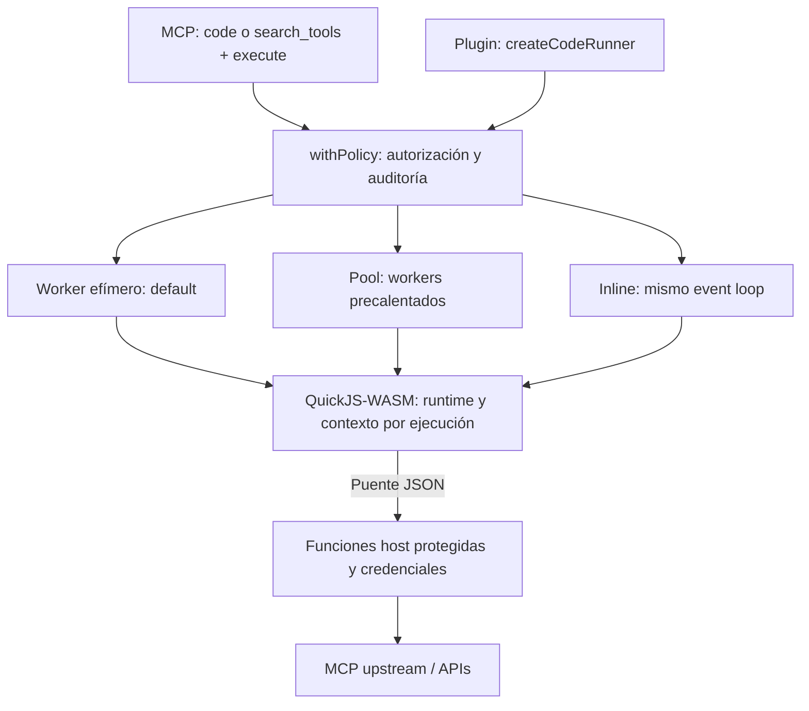

# ARCHITECTURE

## Principio

Reutilizar primero y escribir solo lo que falta. Las entradas comparten la policy y el contrato de ejecución:

`createCodeModeMcpServer` reutiliza `@cloudflare/codemode/mcp`; discovery entrega tipos por subconjunto. El puente serializa valores JSON sin inyectar handles del host. Las credenciales se configuran solo en funciones host; esas funciones deben evitar devolver secretos en sus resultados. Los workers comparten proceso con el padre: el diagrama no representa aislamiento de sistema operativo.

## Componentes seleccionados (de los 9 candidatos del ancla)

| Candidato | Decisión | Dónde |
|---|---|---|
| Tool Discovery | Sí: búsqueda léxica + tipos por subconjunto. En el caso de 83 herramientas, el JSON de `listTools().tools` baja de 39 816 a 1 709 caracteres: **23,30×** [R, tres corridas idénticas; `tests/discovery.test.ts`, umbral 20×]. No mide número de llamadas ni tokens. | `discovery.ts` |
| Schema / Interface | Reutilizado: generador de Cloudflare vendorizado | `vendor/cf-json-schema-types.ts` |
| Tool Composition | Sí, como helpers dentro del sandbox, no como framework | `sandbox/helpers.js` |
| Execution | Solo para Node, donde no existía. Worker por defecto, después de la revisión S3 | `executor/` |
| MCP Adapters | Una conexión upstream, catálogo paginado completo y cierre según propiedad; puente interno hacia `codeMcpServer` + servidor search/execute | `mcp.ts`, `discovery.ts`, `mcp-resources.ts` |
| Policies | Sí, como decorador del `Executor` | `policy.ts` |
| Observability | Mínima: registros de auditoría y logs capturados. Sin OTel, porque nada lo requiere hoy | `policy.ts` |
| Recipes | 3 builders parametrizados | `recipes.ts` |
| Templates | Los ejemplos funcionan como plantilla, sin generador | `examples/` |

## Decisiones

1. **TypeScript como lenguaje principal.** Los consumidores (SDK de MCP, `@cloudflare/codemode`, plugins JS) son TS/JS. Python queda solo como snippet para Claude PTC.
2. **La policy es un decorador del `Executor`, no del servidor.** Así se aplica por igual con `codeMcpServer`, con search/execute, con `createCodeRunner` y con cualquier otro executor que cumpla el contrato (incluido `DynamicWorkerExecutor` en Workers). El código del guest solo alcanza las funciones ya envueltas, por lo que no puede saltarse la policy. Los `connectors` de Cloudflare (RPC directo) se rechazan, porque sí la saltarían.
3. **Fail-closed por defecto.** Una herramienta sin clasificar se deniega, y una escritura sin hook `approve` también. M1 cierra el estado en el `finally` de `withPolicy`, aborta el `signal` del aprobador y comprueba el cierre justo antes de entrar a la función host. Una función ya iniciada puede acabar después: su auditoría lleva `afterExecutionEnd`. M2 exige nombres exactos para allowlists y validadores ante colisiones de sanitizado; `deny` sigue sanitizado. Las variantes ambiguas no permitidas se excluyen de los tipos anunciados.
4. **Puente solo de strings JSON.** Ningún handle de objeto del host entra al guest: no existe una cadena `constructor` que lleve al realm del host.
5. **Worker thread por ejecución (por defecto).** La revisión independiente mostró que, en modo inline, un bucle de CPU congela el event loop y un desbordamiento de stack podía dejar inservible el módulo WASM. M5 reprodujo el bloqueo con 0 ticks durante el bucle. El worker permite al padre seguir atendiendo eventos y descartar el módulo al terminar la ejecución: p50 61,53 ms en el bench actual. El modo inline sigue disponible y recicla el módulo cuando detecta un fallo de limpieza. Ninguno protege al proceso contra todo fallo nativo.
6. **Pool de workers opt-in (Fases 2–3).** `PooledWorkerExecutor` reutiliza el worker y su módulo WASM cargado, nunca el estado del guest: cada ejecución crea runtime y contexto QuickJS nuevos. Reciclaje conservador: cualquier ejecución con error (incluido un `throw` normal), timeout, crash del worker o salida descarta el slot; también al llegar a `maxUses` (default 100) y tras `idleMs` ocioso (default 30 s). Con `prewarm: true`, M4 inicia un reemplazo al reciclar, salvo por inactividad o cierre, prioriza slots ya listos y expone `stats.warming`. `prewarm: false` conserva el arranque bajo demanda. Los mensajes llevan `job` id y el worker descarta respuestas de jobs anteriores. El timeout duro cubre el arranque. No es el default porque mantiene hilos y agrega `close()` al ciclo de vida. Sin `stderr: true` (ese stream retiene el proceso aun con `unref`): el worker del pool silencia su propio stderr, lo que limita el diagnóstico. `stats.alive` cuenta slots, no hilos cuya terminación todavía está pendiente.
7. **Sin replay ni aprobación durable.** El motor de Cloudflare depende de Durable Objects. Aquí cada escritura espera una aprobación booleana o asíncrona para una copia de sus argumentos. La ejecución conserva un snapshot privado, separado de caller, validador y aprobador. Una falla del sink de auditoría no transforma una escritura terminada en un error reintentable: el sink es responsable de sus errores de entrega.

## Contratos reforzados durante la revisión del PR #2

El prefijo de proveedor se comprueba antes de comparar nombres exactos o sanitizados, también en deny y validadores. Un nombre real con puntos se declara como `proveedor.nombre.con.punto`. Las reglas M1/M2 de cierre y colisiones se conservan.

Los dos adaptadores leen todas las páginas del catálogo con detección de cursor repetido y mantienen abierta la conexión upstream hasta el cierre. El adaptador `code` ofrece ese snapshot completo al cliente interno de Cloudflare mediante un puente MCP. Discovery usa el mismo catálogo para búsqueda, bindings y colisiones. El SDK reemplaza su caché de metadatos en cada `listTools`; un wrapper conserva los validadores públicos de `outputSchema` y rechaza herramientas que exigen ejecución por tareas en cualquier página. Se conserva el resultado MCP crudo para el orden de unwrapping existente.

La limpieza se comparte entre cierre explícito, desconexión del consumidor y fallo de inicialización. Cierra la conexión creada por el adaptador y el pool que creó internamente, dejando los executors suministrados bajo propiedad del caller. Un upstream ya conectado se rechaza sin cerrarlo. `maxResponseChars` de search/execute incluye errores y el marcador de truncamiento.

El pool no repone indefinidamente workers que nunca completaron warmup: sólo vuelve a intentar por demanda encolada. Un slot reservado que muere antes de iniciar su job devuelve el error de cierre sin esperar el watchdog. `close()` espera tanto slots vivos como terminaciones de workers ya reciclados; llamadas repetidas comparten la espera. `stats.alive` continúa contando slots, no hilos nativos en terminación. Los logs guest todavía pueden perderse en crashes y terminación forzada porque viajan en el resultado final.

## Portabilidad

| Código | Requiere |
|---|---|
| `src/sandbox/helpers.js`, recipes generadas | cualquier sandbox Code Mode JS (Node con QuickJSExecutor, Cloudflare Workers, iframe). Sin imports |
| `snippets/ptc_helpers.py` | PTC compatible o cualquier Python asyncio; versión documental vigente `code_execution_20260521`, sin verificación con modelo real |
| `policy.ts`, `discovery.ts#searchTools` | cualquier runtime JS (sin APIs de Node, salvo `setTimeout`) |
| `executor/`, `runner.ts`, `helpers.ts` | Node ≥ 22.18; fuentes con type stripping en desarrollo y JS compilado para consumidores; `readFileSync` para helpers |
| `mcp.ts`, `discovery.ts#createSearchExecuteMcpServer` | Node + `@modelcontextprotocol/sdk` ^1.25 + zod 4 |
| Proveedor concreto | ninguno obligatorio. Cloudflare se usa como biblioteca, no como plataforma |

Un plugin de ChatGPT, Claude Code y un servidor MCP independiente **no** tienen las mismas capacidades. Un servidor MCP en Node usa `mcp.ts`. Un plugin JS con herramientas propias usa `runner.ts`. Un host con Code Mode nativo usa solo helpers y recipes.

## Distribución y verificación de deriva (D1 = B)

`dist/` está commiteado: `code-dope` y `code-dope/mcp` exportan JavaScript y declaraciones TypeScript. No hay `prepare`, de modo que instalar la dependencia no necesita compilarla ni autorizar scripts de build. `npm run build` borra `dist/`, emite con TypeScript **5.9.3** y copia `src/sandbox/` porque `helpers.ts` carga `helpers.js` desde disco. `WORKER_ENTRY` selecciona `.ts` en desarrollo y `.js` en el build; esa URL no la reescribe tsc.

Cada commit que cambia `src/` incluye su build. `check:dist` reconstruye y compara `dist/` con el índice de Git y rechaza archivos generados sin versionar; por eso el build actualizado debe estar agregado al índice antes del gate. `test:pkg` hace `npm pack`, instala el tarball en un directorio creado con `mkdtemp` y ejecuta consumidores inline, worker, pool y TypeScript. El gate completo es `npm run test:all`.

Se verificó la instalación del tarball con npm 11.19.1 y Node v24.22.3 en esta fase. Las instalaciones desde `git+file://` con npm 10.9.9 y pnpm 10.28 pertenecen al prototipo D1 documentado en [PLAN.md](PLAN.md). Bun sigue sin prueba directa.

## Rendimiento y carga medidos

20 muestras sintéticas por caso, MCP en memoria, Node v24.22.3. Fuente: [bench/RESULTS.json](bench/RESULTS.json).

| Ejecución | p50 (ms) | p95 (ms) |
|---|---:|---:|
| Worker efímero | 61,53 | 87,29 |
| Pool caliente | 2,74 | 5,88 |
| Pool tras error y 150 ms de margen | 6,07 | 7,94 |
| Pool frío, `prewarm: false` | 50,92 | 53,81 |
| Inline | 2,44 | 4,64 |

Los 150 ms para que se caliente el reemplazo quedan fuera del intervalo medido. El pool frío se crea por muestra e incluye el arranque en `execute`. El caso tras error cumple p50 < 15 ms bajo esas condiciones. Tokens reales, latencia del modelo y red externa siguen **NOT_VERIFIED**.

[bench/SOAK.json](bench/SOAK.json) conserva un primer intento con **exit 139 / `Segmentation fault`**, comparaciones acotadas y un reintento completo de 5 000 ejecuciones para cada `maxUses` (100 y 1 000). En el reintento hubo 0 resultados inesperados, 502 workers creados por configuración y ninguna alerta de tendencia: RSS final/inicial 1,162× y 1,023×; p95 0,847× y 1,126×. El crash nativo no tiene causa identificada. Las comparaciones de 500 por configuración antes y después de M4 pasaron, sin demostrar si el cambio está relacionado con el fallo. Esta carga recicla workers por errores con frecuencia; no valida 1 000 usos exitosos consecutivos ni prueba ausencia general de fugas.

[bench/POOL-LIFECYCLE.json](bench/POOL-LIFECYCLE.json) registra cinco escenarios funcionales sintéticos, nueve workers y 78 eventos observados desde el padre. Cada cierre terminó sin slots vivos y todas las terminaciones observadas completaron. Esa traza acota el orden de eventos del contrato; no incluye stack nativo ni identifica la causa de exit 139. Las cifras del benchmark y del soak anteriores se conservan como evidencia de Fase 3, sin atribuirlas al candidato corregido ni presentarlas como latencia end-to-end o ahorro de tokens.
