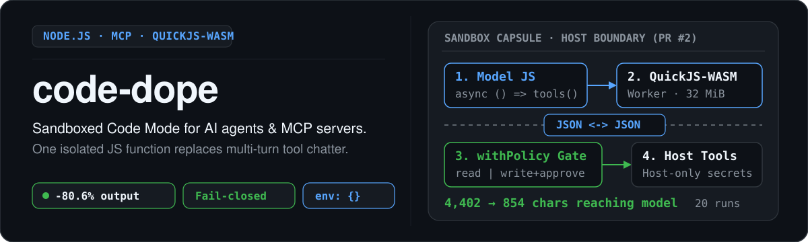
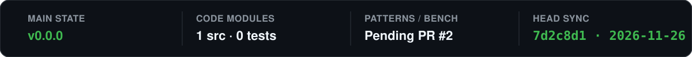
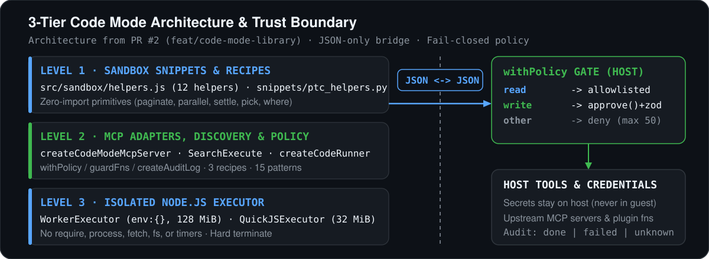

> **Branch status note:** `main` currently holds the bootstrap TypeScript package, governance/CI scaffolding (`PR #1` & `PR #4` merged), and automated README-sync baseline. The full Code Mode runtime, executors, recipes, tests, and benchmarks live on open PR #2 (`feat/code-mode-library`). All dynamic sections below (`AUTO:*`) reflect the live `main` tree and auto-update on merge.

[Roadmap](docs/roadmap.md) · [Agents](AGENTS.md) · [Contributing](CONTRIBUTING.md) · [Anchor](ANCHOR.yaml) · [Glossary](GLOSSARY.md) · [Security](SECURITY.md)

<!-- AUTO:STATUS:START -->
| Field | Value |
| --- | --- |
| Branch / Release | `v0.0.0` (`main`) |
| Node.js Target | `>=24 <25 (.node-version: 24)` |
| Tracked Files | 1 src · 0 examples/snippets · 0 tests · 7 scripts |
| HEAD Commit | `bf5057d` (2026-11-26) |
| Core Library | Bootstrap on `main` (PR #2 pending) |
<!-- AUTO:STATUS:END -->

---

## Why `code-dope`

Traditional tool calling forces an AI model to bounce back and forth across multiple turns—loading raw tool payloads into context on every hop. **Code Mode** flips that loop: the model writes a single JavaScript `async` arrow function that composes multiple tools, filters and aggregates intermediate payloads inside a **QuickJS-WASM** sandbox, and returns only the distilled result across a **fail-closed host policy boundary**.

`code-dope` packages the sandbox, host policy gates, MCP adapters, discovery search, and reusable patterns so AI agents, plugins, and MCP servers do not have to re-implement them from scratch.

### Verified Proof (from PR #2 `feat/code-mode-library`)

Measured on Node `v22.23.5` (synthetic data, in-memory MCP, median of 20 runs in `bench/RESULTS.json` on `origin/feat/code-mode-library`):

- **80.6% less tool output reaching the model:** `4,402` chars (baseline) → `854` chars (Code Mode), with the same `5` underlying tool invocations.
- **Partial failure handling in one call:** When `customer c-1` is unavailable, baseline returns an error and costs `1` extra turn; Code Mode returns `{ complete: false, partialOrdersReturned: 10, failedCustomers: [{ id: "c-1", error: "customer c-1 unavailable" }] }` in the same call.
- **24x smaller tool surface on large catalogs:** `createSearchExecuteMcpServer` (`search_tools` + `execute`) reduced `listTools` payload size by `24x` on an 83-tool catalog (`ARCHITECTURE.md` on `origin/feat/code-mode-library`).
- **Tradeoff:** Code Mode trades ~`101.14 ms` median worker overhead (~`5.04 ms` inline) and a longer tool definition (`2,479` vs `928` chars) to cut model turns (`6` sequential / `4` parallel → `2` scripted) and cumulative context (`25,470` → `6,533` chars estimated).

---

## Architecture: 3 Tiers & Trust Boundary



| Tier | Scope (PR #2 `feat/code-mode-library`) | Key Primitives |
| --- | --- | --- |
| **Level 1 · Sandbox Snippets** | Hosts with native Code Mode (Cloudflare, Claude PTC) | Zero-import `src/sandbox/helpers.js` (`parallel`, `settle`, `paginate`, `batch`, `retry`, `pick`, `where`, `countBy`, `summarize`, `requireFields`, `evidence`, `result`) and `snippets/ptc_helpers.py` |
| **Level 2 · Adapters, Discovery & Policy** | Plugins and MCP servers | `createCodeModeMcpServer`, `createSearchExecuteMcpServer` (`searchTools`, `typesFor`), `createCodeRunner`, `withPolicy` / `guardFns` / `createAuditLog`, 3 recipes (`paginatedFilter`, `fanOutEnrich`, `guardedBulkUpdate`), 15 indexed patterns (`catalog/patterns.json`) |
| **Level 3 · Node.js Executors** | Hosts without native Code Mode | `WorkerExecutor` (default: disposable `node:worker_threads`, `env: {}`, `128 MiB` V8 heap, `1,000 ms` kill grace, hard `worker.terminate()`) wrapping `QuickJSExecutor` (`quickjs-emscripten@0.32.0`) |

---

## Repository Modules (Live on `main`)

<!-- AUTO:MODULES:START -->
| Area | Files | Contents |
| --- | --- | --- |
| `src/` | 1 | `src/index.ts` |
| `examples/` | 0 | Pending merge (`PR #2 feat/code-mode-library`) |
| `snippets/` | 0 | Pending merge (`PR #2 feat/code-mode-library`) |
| `scripts/` | 7 | `scripts/check-docs.mjs`, `scripts/check-secrets.sh`, `scripts/package.test.mjs`, `scripts/scan-staged-secrets.mjs`, `scripts/scan-staged-secrets.test.mjs`, `scripts/update-readme.mjs`, +1 more |
<!-- AUTO:MODULES:END -->

---

## Benchmarks & Pattern Catalog

<!-- AUTO:BENCHMARKS:START -->
| Source | Status | Details |
| --- | --- | --- |
| `bench/RESULTS.json` | Pending PR #2 merge | Auto-populates measured Code Mode vs baseline metrics upon merge |
| `catalog/patterns.json` | Pending PR #2 merge | Auto-populates indexed pattern counts and levels upon merge |
<!-- AUTO:BENCHMARKS:END -->

---

## Quickstart & Usage

### 1. Live on `main`: Bootstrap Package & README Sync

```bash
pnpm install --frozen-lockfile
pnpm typecheck
pnpm test
node scripts/update-readme.mjs          # sync AUTO blocks & status SVG from repo state
node scripts/update-readme.mjs --check  # verify zero drift (exits non-zero if stale)
```

### 2. Core Library Usage (PR #2 `feat/code-mode-library`, pending merge)

Once PR #2 merges, `code-dope` runs on **Node >= 22.18** using native ESM TypeScript type-stripping (no build step required):

```bash
npm install
npm run test:all      # JS tests + Python tests + typecheck
npm run bench         # synthetic in-memory MCP benchmark
npm run example:plugin
npm run example:mcp
```

#### Wrap an existing MCP server with `code` + fail-closed policy

```ts
import { createCodeModeMcpServer } from "code-dope/mcp";

const server = await createCodeModeMcpServer({
  upstream: myMcpServer,
  policy: {
    read: ["list_orders", "get_customer"],
    write: ["update_order"],
    approve: async ({ tool, args }) => askHuman(tool, args),
    maxCalls: 50,
    audit: (entry) => log(entry),
  },
});
await server.connect(new StdioServerTransport());
```

For large tool catalogs, use `createSearchExecuteMcpServer` to expose `search_tools` + `execute` and load schemas only for matched tools.

#### Run sandboxed Code Mode in a plugin (without MCP)

```ts
import { createCodeRunner, paginatedFilter } from "code-dope";

const runner = createCodeRunner({
  tools: { notes: { list_notes, archive_note } },
  policy: { read: ["list_notes"], write: ["archive_note"], approve },
});

const code = paginatedFilter.build({
  namespace: "notes",
  listTool: "list_notes",
  cursorArg: "offset",
  where: { tag: "ideas" },
});
const res = await runner.run(code);
// res.result, res.error, res.logs, res.audit
```

#### Inside the sandbox

```js
async () => {
  const all = await helpers.paginate((cursor) =>
    codemode.list_orders(cursor == null ? {} : { cursor })
  );
  const settled = helpers.settle(
    await helpers.parallel(ids.map((id) => () => codemode.get_customer({ id })))
  );
  return helpers.summarize(
    helpers.pick(helpers.where(all.items, { status: "pending" }), ["id", "total"])
  );
}
```

---

## Security Boundaries & Known Limits

Designed for defense-in-depth in PR #2 (`feat/code-mode-library`), with explicit operational boundaries:

- **JSON-only host bridge:** Model code runs inside `QuickJSExecutor` (`quickjs-emscripten@0.32.0`) with no `require`, `process`, `fetch`, `fs`, or timers. Only JSON strings cross the bridge; host objects and credentials stay outside the guest.
- **Disposable worker isolation:** `WorkerExecutor` (default) spawns a fresh `node:worker_threads` instance with `env: {}` and a `128 MiB` heap limit, terminating the worker if execution hits the deadline. `QuickJSExecutor` enforces `timeoutMs: 30_000`, `memoryLimitBytes: 32 MiB`, `maxStackBytes: 512 KiB`, `maxLogLines: 200`, and `maxPendingCalls: 64`.
- **Fail-closed host policy:** `withPolicy` wraps host functions before the sandbox sees them: unclassified tools are denied, writes require per-call `approve()` (sync or async) plus argument / Zod `safeParse` validation, and tool names are matched sanitized (`delete-user` == `delete_user`). Defaults: `maxCalls: 50`, `callTimeoutMs: 15_000`, `maxResultChars: 1_000_000`, and audit outcomes `"done" | "failed" | "unknown"`.
- **Known limits & `NOT_VERIFIED` items:**
  - `quickjs-emscripten` is not security-audited, and a `worker_threads` worker shares the host OS process—run hostile workloads inside an OS container or low-privilege process.
  - A timed-out write tool may still complete on the host (`outcome: "unknown"`), so write tools should be idempotent.
  - Tool outputs can carry prompt injection; tool descriptions warn the model, but responses are not sanitized.
  - Real LLM token counts, real model latency, unaided LLM code generation, and networked MCP servers are `NOT_VERIFIED` in the synthetic benchmark.

---

## Recent Merges & Commits

<!-- AUTO:RECENT_MERGES:START -->
| Commit | Date | Summary |
| --- | --- | --- |
| `bf5057d` | 2026-11-26 | Merge pull request #6 from fegome90-cmd/docs/beautify-readme-auto-sync |
<!-- AUTO:RECENT_MERGES:END -->

---

## Auto-Sync Workflow

This repository keeps `README.md` and `assets/readme/status-badge.svg` synchronized with protected `main` automatically via `.github/workflows/update-readme.yml` and `scripts/update-readme.mjs`:

1. Every push to `main` (including PR merges) or manual `workflow_dispatch` runs `node scripts/update-readme.mjs` with `fetch-depth: 0` (skipping commits authored by `github-actions[bot]` or carrying the `Auto-Sync: readme` trailer).
2. The script deterministically refreshes `AUTO:STATUS`, `AUTO:MODULES`, `AUTO:BENCHMARKS`, `AUTO:RECENT_MERGES`, and `AUTO:SVG_STATUS` from live repository files and non-sync git history so sync merges converge to a fixed point.
3. If `README.md` or `assets/readme/status-badge.svg` changed, the workflow force-pushes branch `docs/sync-readme` and opens or updates a PR targeting `main` using `secrets.README_SYNC_TOKEN` (required so the PR passes the repository ruleset and triggers the `Bootstrap` CI checks).
