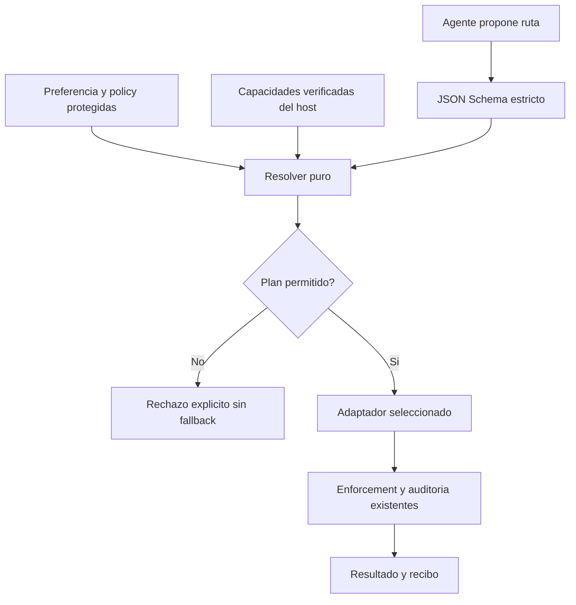

# Code Dope — Informe consolidado de avance

**Fecha:** 27 de noviembre de 2026  
**Alcance:** EGM Core Hardening (PR #10) y Capability Selection & Agent-Driven Configuration.  
**Repositorio:** https://github.com/fegome90-cmd/code-dope  
**Baseline:** `0bd8cbc8ed278ad93ac7f5d69c0ccc4cf932b71a` (v0.1.0).  
**Naturaleza:** informe de seguimiento y decisión; no constituye autorización de implementación, merge ni publicación.


> **Revisión v3 (27-11-2026):** la parte III contiene la nueva auditoría de repositorios, código candidato, pruebas y decisiones revisadas. Preserva las partes I–II como historial; las cifras y propuestas anteriores no constituyen el estado más reciente del fixture. Comenzar en [Parte III](#parte-iii--revisión-profunda-de-upstream-y-prototipo-integrable-v3).

> **Revisión v2 (27-11-2026):** la parte I conserva el informe anterior como corte histórico. La parte II contiene la investigación nueva, inspección upstream, diseño reuse-first y el PoC ejecutado. La parte II precisa la propuesta de Capability Selection y sus límites; el gate de hardening no se revalida en esta revisión.

# PARTE I — Informe de seguimiento histórico

## 1. Resumen ejecutivo

| Línea | Resultado disponible | Estado |
|---|---|---|
| Core Hardening | Candidato `design_draft.pr10.candidate.md`, draft-r1, 145 líneas; 17 hallazgos abordados documentalmente en cuatro fases | BLOCKED: falta reconciliación independiente y gate de diseño |
| Capability Selection | Propuesta de resolver determinista, configuración declarativa e interfaces de consumo | PRELIMINAR: sin prototipo ni validación acreditados |

La dirección compartida es **máxima capacidad disponible, mínima complejidad efectiva**. El núcleo debe ser robusto, las capacidades avanzadas opcionales y los controles obligatorios no desactivables. No se recomienda condicionar el cierre del hardening al desarrollo del sistema general de configuración.

## 2. Core Hardening — estado comprobado

### 2.1. GitHub

- PR #10 abierto, sin conflictos de integración, de `developer` a `tester`. HEAD: `0bd8cbc8ed278ad93ac7f5d69c0ccc4cf932b71a`. Base tester: `ab09eee621de379b5059376f47f3f7a61e30ae63`.
- Dos hilos de revisión no resueltos: [colisión de namespaces con globales](https://github.com/fegome90-cmd/code-dope/pull/10#discussion_r4714573576) y [cierre del pool desde CodeRunner](https://github.com/fegome90-cmd/code-dope/pull/10#discussion_r4714573578).
- No se localizó la rama remota `fix/pr10-core-hardening` ni cambios de hardening integrados en developer. La inexistencia remota no demuestra ausencia de trabajo local.
- El PR #11 de linters y pre-commit es un carril distinto; no constituye evidencia de cierre del hardening.
- [CI histórico del baseline](https://github.com/fegome90-cmd/code-dope/actions/runs/45908088279): 4/4 checks según la evidencia del PR; 177 pruebas JS, cinco Python, cinco de infraestructura, instalación de consumidor 1/1 y 510/542 ramas modificadas cubiertas (94,1%). No son pruebas del nuevo candidato.
- No hubo merge del PR #10. El mergeable técnico no equivale a aprobación de los gates ni a autorización de promoción.

### 2.2. Hallazgos y candidato

El informe consolidado enumera 6 bloqueantes (B), 7 mayores (M) y 4 menores (N). Su encabezado menciona 9 mayores. El contrainforme atribuye la discrepancia a un error de conteo y señala referencias omitidas en la matriz, pero falta recuperar los informes originales S5–S9 y `design_draft.md` para una reconciliación independiente. No se atribuyen hallazgos nuevos por inferencia.

| ID | Problema | Resolución propuesta en draft-r1 | Cierre |
|---|---|---|---|
| B1 | Serialización e intrínsecos | Captura de handles y referencias léxicas sin global auxiliar; considerar `getPromiseState()` | NOT_VERIFIED |
| B2 | Promesas, handles, memoria, abort y cleanup | Estado terminal único, ownership, settlement sin doble resolución, tratamiento de OOM | NOT_VERIFIED |
| B3 | Colisiones de namespaces y prototipos | Validar todos los nombres contra propiedades propias/heredadas, internos y duplicados | NOT_VERIFIED |
| B4 | Extracción de discovery | Separar `discovery-core.ts` del adaptador MCP, preservar exports | NOT_VERIFIED |
| B5 | Allowlist | Corregir archivos de pruebas y dist permitidos | NOT_VERIFIED |
| B6 | Packaging y tipos | Instalaciones aisladas con/sin peers MCP/Zod, compilación estricta | NOT_VERIFIED |

M1–M7 y N1–N4 tienen tratamiento documental en la matriz del candidato. Ninguno se declara cerrado mediante pruebas ejecutadas. La propuesta de `ManagedCodeRunner` preserva la interfaz estructural de `CodeRunner` y añade `close()` explícito desde la fábrica. `Symbol.asyncDispose` se difiere: no existe en el baseline, por lo que no se retira una capacidad existente. Worker permanece predeterminado; inline y pool siguen disponibles por selección explícita.

### 2.3. Reuse-first

El candidato utiliza las APIs de QuickJS 0.32.0 (`getProp`, `callFunction`, `getPromiseState`, `newPromise`, `executePendingJobs`, `alive`, `dispose`), mantiene el contrato de Cloudflare Code Mode 0.5.6 y los módulos vendorizados MIT. Adopta patrones de UTCP sin copiar código MPL ni sumar `isolated-vm`; Anthropic aporta patrones de composición y filtrado, no un runtime portable. La inspección estática upstream está reportada; la ejecución de sus pruebas y de las nuevas regresiones no está acreditada.

### 2.4. Fases propuestas y gates

| Fase | Alcance | Evidencia exigida |
|---|---|---|
| 0 | Recuperar diseño original e informes S5–S9; comparar draft-r1; revisión independiente | Gate de diseño PASS y autorización expresa de implementación |
| 1 | QuickJS: namespaces, intrínsecos, promesas, límites | RED→GREEN; timeout, OOM, callbacks tardíos, handles y regresiones worker/pool |
| 2 | Runner: `ManagedCodeRunner`, cierre y auditoría | Cierre idempotente, concurrencia, rechazo post-close y compatibilidad de tipos |
| 3 | Policy fail-closed | Validadores malformados o rechazados no invocan herramientas; preservar presupuestos y permisos |
| 4 | Discovery, peers y packaging | Instalaciones independientes, TypeScript estricto, exports, build/dist, `npm run test:all`, CI |

El candidato informa bloqueo de Desktop Commander por cuota, falta de acceso al worktree/diseño original y ausencia de ejecución Goldfish independiente. El candidato reconstruido no es un diff del original y no debe sustituirlo sin comparar. El fallo nativo intermitente del pool sigue sin causa resuelta; pool permanece opt-in. La integración del parche debe pasar por PR separado a `developer`, y la promoción a `tester` requiere nueva verificación y decisión humana.

## 3. Capability Selection — investigación arquitectónica

### 3.1. Resultado preliminar recuperado

La investigación original propone un patrón CDE: separar la interpretación probabilística del agente de la aplicación determinista de una configuración. Contrato conceptual:

```ts
resolve(requestedConfig, hostCapabilities, userPermissions, policyVersion)
```

El agente solicita capacidades; el resolver valida entradas, dependencias, compatibilidad, precedencia y restricciones; devuelve una configuración efectiva y un recibo verificable. El determinismo exige entradas normalizadas, versiones fijadas y ausencia de dependencia implícita de estado cambiante. AUTO no convierte al modelo en un decisor determinista: el modelo propone, el resolver valida y aplica.

| Modo | Contrato preliminar |
|---|---|
| OFF | Ruta directa si el host la ofrece y está autorizada; no inicializar Code Mode |
| ON | Seleccionar Code Mode si existe un adaptador compatible y autorizado; informar incompatibilidad sin bypass |
| AUTO | Selección del agente dentro del conjunto permitido; validación determinista posterior |

Executor, sandbox, pool, discovery y telemetría podrían configurarse cuando corresponda. Las capacidades avanzadas no deben desactivar controles de aislamiento, autorización, presupuesto o registro mínimo exigido. Una configuración no concede permisos nuevos.

### 3.2. Interfaces y responsabilidades

| Interfaz | Función propuesta | Estado |
|---|---|---|
| JSON declarativo | Solicitud estructurada y fuente de configuración | Propuesta |
| API | Núcleo integrable en aplicaciones | Propuesta |
| CLI | Descubrimiento, resolución, ejecución e inspección en agentes con terminal | Propuesta |
| MCP | Adaptador para hosts compatibles | Propuesta |
| Cards | Descubrimiento, requisitos y presentación/aprobación humana | Por evaluar |
| Skills | Guía de uso y selección; no sustituyen enforcement | Por evaluar |
| Scripts/hooks | Aplicación automatizada de contratos y políticas | Por evaluar |

CLI conceptual (no implementado ni ejecutado):

```bash
code-dope capabilities --json
code-dope resolve --config run.json
code-dope run --config run.json
code-dope inspect --run-id <id>
```

La propuesta debe compararse con el baseline existente: perfiles o parámetros explícitos de API, `isolation`, helpers, recipes y `catalog/patterns.json`. No se justifica construir todas las interfaces de una vez. El catálogo existente es un candidato de reutilización, no una prueba de que ya resuelve negociación de capacidades.

### 3.3. Motores de restricciones

Una investigación complementaria propone TypeScript como núcleo, BigInt cuando haya aritmética exacta, y explora Z3, cvc5 y LogicNG para restricciones más complejas. No están instalados, seleccionados ni evaluados experimentalmente en Code Dope. Recomendación de este informe: probar primero un resolver puro TypeScript con reglas explícitas; usar un solver solo si se demuestra un problema de satisfacibilidad o combinatoria que justifique su coste. No incorporar la investigación matemática de FALP al PR #10 ni asumir que todo switch requiere un solver.

### 3.4. Evidencia aún faltante

No se localizaron los entregables finales `RESEARCH-CAPABILITY-SELECTION.md` y `DESIGN-CAPABILITY-SELECTION.md`, un prototipo ejecutable del resolver, pruebas de carga efectiva, ni integración real de la propuesta en Claude Code, Codex o plugins GPT. Los precedentes mencionados (OpenCode, UTCP, Cloudflare, OpenAI Agents SDK, OpenFeature y Anthropic) se recuperaron de la respuesta original del investigador, no fueron auditados nuevamente para este informe. No hay benchmark comparativo frente al baseline ni selección de interfaz definitiva acreditada.

## 4. Convergencia y roadmap recomendado

| Prioridad | Acción | Gate de aceptación |
|---|---|---|
| P0-A | Recuperar fuentes EGM originales, cerrar decisiones del draft-r1 y revisión focalizada | PASS independiente de diseño |
| P0-B (paralela) | Finalizar investigación de interfaces; inventariar capacidades y dependencias reales de Code Dope | Contrato de configuración y comparación frente a baseline |
| P1-A | Tras autorización, ejecutar las cuatro fases de hardening | RED→GREEN, pruebas completas y CI de candidato, revisión independiente |
| P1-B | Prototipo aislado de configuración normalizada y resolver determinista mínimo | Misma entrada → misma salida; rechazos seguros; compatibilidad/dependencias verificadas |
| P2 | Seleccionar el primer adaptador necesario (API, CLI o MCP) | Evidencia de uso por un consumidor real y coste proporcional |
| P3 | Evaluar cards/skills, lazy loading, telemetría y motores especializados solo por necesidad demostrada | Beneficio frente al baseline y no regresión de seguridad |

La configuración mínima debe demostrar OFF sin inicializar el runtime, ON compatible, AUTO validado, ausencia de bypass, aislamiento de dependencias opcionales, fallo de capacidad incompatible y ausencia de fallback inseguro tras efectos secundarios. Medir instalación, carga, inicialización y ejecución por separado. Las capacidades del host se comprueban, no se infieren por marca o modelo.

## 5. Decisión recomendada

**Core Hardening: HOLD para implementación/promoción hasta superar el gate correspondiente.** Priorizar los dos hilos activos y el cierre de B1–B6 sin introducir el sistema general de configuración. Conservar pool opt-in y límites documentados.

**Capability Selection: GO para investigación y prototipo aislado, no para integrar ni publicar.** La hipótesis a contrastar es un resolver determinista pequeño, una configuración única y adaptadores delgados según necesidad. No aprobar todavía CLI + MCP + cards + skills + motor formal como paquete obligatorio.

No es necesario paralizar la investigación B mientras se desbloquea A. La convergencia debe producirse por contratos estables y evidencia, no por una reestructuración simultánea del repositorio.

## 6. Fuentes y límites

- [PR #10 de Code Dope](https://github.com/fegome90-cmd/code-dope/pull/10): metadata y dos hilos consultados directamente el 27-11-2026.
- [Rama developer fijada al baseline](https://github.com/fegome90-cmd/code-dope/tree/0bd8cbc8ed278ad93ac7f5d69c0ccc4cf932b71a): referencia de repositorio.
- `Consolidated EGM Goldfish Review Report — PR #10 Core Hardening`, proporcionado en la conversación: hallazgos originales y matriz de trazabilidad.
- `design_draft.pr10.candidate.md`, draft-r1 del 27-11-2026, 145 líneas: documento leído íntegramente para este informe; incluye contratos, fases, pruebas previstas, matriz y estado BLOCKED.
- Conversaciones de investigación de configuración determinista y motores de restricciones del 27-11-2026: propuestas recuperadas, no equivalentes a evidencia experimental ni documentos finales.

Estados: PASS = comprobación ejecutada favorable; FAIL = criterio incumplido; BLOCKED = prerrequisito no disponible; NOT_VERIFIED = evidencia no obtenida. PRELIMINAR identifica una propuesta sin gate técnico acreditado. No se asigna porcentaje de avance: no existe un denominador de trabajo medido. Este informe no ejecutó pruebas, no realizó modificaciones de código, no despachó agentes y no observó su ejecución en tiempo real. El estado remoto y las fuentes recuperadas no excluyen trabajo local aún no compartido. El roadmap es una recomendación del informe, no una decisión de implementación aprobada.

---

# PARTE II — Investigación REUSE-FIRST: Capability Selection & Agent-Driven Configuration

**Revisión:** v2 · 27-11-2026. **Estado:** propuesta técnica contrastada con código fuente y PoC aislado; no autorizada para integración. Esta parte amplía y precisa la sección 3 del informe histórico. No altera los gates de Core Hardening ni declara un nuevo estado remoto de PR #10.

## 7. Conclusión de la investigación

La alternativa con menor código propio es **una solicitud JSON pequeña, un resolver puro y adaptadores existentes seleccionados bajo demanda**. El modo ON/OFF/AUTO es un límite fijado por el consumidor autorizado; el agente propone una ruta concreta. El catálogo existente orienta su elección. El host verifica disponibilidad y permisos. No se necesita de entrada un motor genérico de feature flags, un DSL, un solver SAT/SMT, una base de datos, otro LLM ni un nuevo runtime.

Hallazgo adicional importante: OpenCode ofrece actualmente un paquete de Code Mode independiente, `@opencode/codemode`, cuyo manifiesto en el commit inspeccionado declara 2.4.1. Es un candidato real a reutilización de runtime en una fase posterior, no una sustitución compatible ya probada. Su intérprete `psychoscript` y sus contratos Effect introducen diferencias sustanciales respecto de QuickJS. Evaluarlo en un spike aislado puede evitar desarrollar más piezas propias a largo plazo.

**Recomendación:** primero reutilizar lo que Code Dope ya contiene; después agregar únicamente el pegamento necesario para activar rutas sin cargar las demás. El CLI es un adaptador potencial, no el núcleo. Una skill y una card son material de descubrimiento/uso, no fuentes de autorización. El núcleo debe poder usarse incluso sin ellas.

## 8. Método y límites de evidencia

- Leí el informe v1 y el snapshot fijado de Code Dope `0bd8cbc8ed278ad93ac7f5d69c0ccc4cf932b71a` mediante GitHub. Contrasté los archivos y contratos pertinentes con el lockfile. No interpreté la documentación como prueba de una ejecución.
- Inspeccioné código original de Cloudflare, OpenCode, cfworker, OpenAI Agents SDK y documentación primaria de Node, npm, MCP, Claude Code, Agent Skills, JSON Schema y OpenFeature. Las referencias fijadas a commits permiten repetir las lecturas; las referencias a ramas móviles se marcan explícitamente.
- Escribí y ejecuté un fixture neutral de configuración en un directorio temporal independiente. No se ejecutó código de usuarios ni se modificó Code Dope, sus PR, plugins o configuración global.
- La instalación de `@cfworker/json-schema@4.1.6` falló por resolución DNS del registro npm (`EAI_AGAIN`). Por eso validé el esquema con Python `jsonschema` 4.26.0 y las reglas del resolver con Node 22.16.0. No ejecuté el validador npm, QuickJS, OpenCode ni los hosts reales en este entorno. Node 22.16.0 está por debajo del requisito de Code Dope (22.18); los resultados son del fixture, no de la librería.
- No se ejecutaron subagentes independientes, benchmarks de tokens/latencia, auditorías de vulnerabilidades nuevas ni CI del repo. No hay prueba de estabilidad general de ningún runtime. No se localizó ni se usó como fuente un informe final externo de Capability Selection.

Estados de esta parte: **REUSE** = reutilización propuesta con API/código identificado; **ADAPT** = integración propia necesaria; **DEFER** = no se justifica ahora; **PASS-POC** = ensayo aislado ejecutado; **NOT_VERIFIED** = prueba real pendiente.

## 9. Inventario del código propio que ya podemos reutilizar

Baseline: [árbol fijado](https://github.com/fegome90-cmd/code-dope/tree/0bd8cbc8ed278ad93ac7f5d69c0ccc4cf932b71a). Los símbolos siguientes fueron inspeccionados en ese commit.

| Necesidad | Código existente | Reutilización y límite |
|---|---|---|
| Descubrir capacidades | [`catalog/patterns.json`](https://github.com/fegome90-cmd/code-dope/blob/0bd8cbc8ed278ad93ac7f5d69c0ccc4cf932b71a/catalog/patterns.json) | **REUSE**: 15 patrones con ID, nivel, tareas, fuente, dependencias, entorno, permisos, pruebas y procedencia. No inventar un segundo registry. Es un índice descriptivo, no una lista de capacidades autorizadas ni un resolvedor. |
| Elegir ejecutor local | [`src/executor/default.ts`](https://github.com/fegome90-cmd/code-dope/blob/0bd8cbc8ed278ad93ac7f5d69c0ccc4cf932b71a/src/executor/default.ts) · `createDefaultExecutor` | **REUSE**: unión `Isolation = worker / inline / pool` y fábrica existente. No escribir un segundo selector de motores. Validar estrictamente antes de llamar: el valor desconocido cae al caso worker en el baseline. |
| Ejecución con herramientas en Node | [`src/runner.ts`](https://github.com/fegome90-cmd/code-dope/blob/0bd8cbc8ed278ad93ac7f5d69c0ccc4cf932b71a/src/runner.ts) · `createCodeRunner` | **REUSE** tras hardening: recibe herramientas, policy, aislamiento y opciones. Instancia el ejecutor al construir; no llamarlo cuando la ruta sea directa o nativa. El cierre del pool depende del PR de hardening. |
| Política común | [`src/policy.ts`](https://github.com/fegome90-cmd/code-dope/blob/0bd8cbc8ed278ad93ac7f5d69c0ccc4cf932b71a/src/policy.ts) · `withPolicy`, `guardFns`, `policyAllows` | **REUSE**: allowlist, deny, clasificación, aprobación, presupuesto, timeout, snapshot de argumentos y registros. No reemplazar por un motor de flags ni clonar reglas. `guardFns` fuera de `withPolicy` no cierra su scope automáticamente; no usarlo sin controlar ciclo de vida. |
| Telemetría mínima | `createAuditLog`, `ToolPolicy.audit`, `AuditRecord` en policy y runner | **REUSE**: registros locales y sink opcional; no existe garantía de entrega durable. OFF de telemetría extendida no apaga auditoría mínima exigida. |
| Discovery | [`src/discovery.ts`](https://github.com/fegome90-cmd/code-dope/blob/0bd8cbc8ed278ad93ac7f5d69c0ccc4cf932b71a/src/discovery.ts) · `searchTools`, `typesFor`, `createSearchExecuteMcpServer` | **REUSE**: ranking léxico y tipos vendorizados. B4 separa núcleo puro del adaptador MCP. La búsqueda actual selecciona descripciones, no concede permisos. No crear vector DB. |
| MCP | [`src/mcp.ts`](https://github.com/fegome90-cmd/code-dope/blob/0bd8cbc8ed278ad93ac7f5d69c0ccc4cf932b71a/src/mcp.ts) · `createCodeModeMcpServer` | **REUSE**: envoltorio `codeMcpServer` de Cloudflare + `withPolicy`. `executor` inyectable; el wrapper `search/execute` ya existe como alternativa. No construir un servidor de transporte nuevo. |
| Composición y helpers | [`src/helpers.ts`](https://github.com/fegome90-cmd/code-dope/blob/0bd8cbc8ed278ad93ac7f5d69c0ccc4cf932b71a/src/helpers.ts), `src/sandbox/helpers.js`, `snippets/ptc_helpers.py`, [`src/recipes.ts`](https://github.com/fegome90-cmd/code-dope/blob/0bd8cbc8ed278ad93ac7f5d69c0ccc4cf932b71a/src/recipes.ts) | **REUSE**: snippets nativos y builders. No convertir estos helpers en un runtime obligatorio. `helpers.ts` usa lectura sincrónica de archivo Node; en otro host usar el snippet compatible, no ese módulo. |
| Validación de configuración | [`package-lock.json`](https://github.com/fegome90-cmd/code-dope/blob/0bd8cbc8ed278ad93ac7f5d69c0ccc4cf932b71a/package-lock.json) | **REUSE**: `@cfworker/json-schema` 4.1.6 ya es dependencia directa de producción. Zod 4.6.7 está como peer/dev. No introducir otro validador para el núcleo. |
| Pruebas y distribución | `node:test`, `scripts/build.mjs`, `tests/package.test.ts`, `npm run test:all` | **REUSE**: mismo tooling; no Jest/Vitest nuevo. La matriz de tests con/sin peers del hardening sigue siendo prerrequisito. |

### 9.1. Cuatro restricciones que impiden prometer OFF efectivo hoy

1. [`src/index.ts`](https://github.com/fegome90-cmd/code-dope/blob/0bd8cbc8ed278ad93ac7f5d69c0ccc4cf932b71a/src/index.ts) reexporta estáticamente ejecutores, helpers y discovery. Importar el entry raíz no es una ruta ligera garantizada. El import de helpers lee un archivo de inmediato; el módulo discovery importa el SDK MCP y Zod.
2. `createDefaultExecutor` importa las clases de los tres ejecutores y añade siempre `SANDBOX_HELPERS` a `preludes`. Esto distingue selección de un constructor de exclusión real del grafo de módulos. `PooledWorkerExecutor` crea workers al construir por defecto (`prewarm: true`).
3. El manifiesto actual expone únicamente `.` y `./mcp`; QuickJS es dependencia directa obligatoria. Los subpaths y `import()` evitan evaluación/carga de módulos no alcanzados, pero no impiden que npm los instale. B4/B6 deben resolver primero los peers MCP; excluir WASM de la instalación es otro problema de packaging.
4. `catalog/patterns.json` es un índice de fuentes del repo. Varios `source` apuntan a `src/`, que no está en `files` del paquete. Un agente que solo tiene el tarball no puede seguirlos como si fueran rutas locales. Solución mínima: conservar `source` para trazabilidad y agregar `artifact`/entrypoint únicamente donde haga falta, probado contra el tarball real; o proporcionar acceso al repo fijado. No duplicar contenido en una base de datos.

**Consecuencia:** OFF puede conseguirse en el adaptador de consumo sin importar Code Dope runtime. En Node, una separación ligera de entrypoints debe preceder a cualquier afirmación sobre carga efectiva. La desinstalación de WASM necesita una decisión adicional de empaquetado, no otro booleano.

## 10. Código y bibliotecas externos recuperados

### 10.1. Selección prioritaria: sin dependencias de producción nuevas para el selector

| Fuente / versión | API o código a reutilizar | Decisión |
|---|---|---|
| [`@cfworker/json-schema`](https://github.com/cfworker/cfworker/blob/main/packages/json-schema/src/validator.ts), lock 4.1.6, MIT | `new Validator(schema, '7')`, `validate(instance).valid`. [Tipo `ValidationResult`](https://github.com/cfworker/cfworker/blob/main/packages/json-schema/src/types.ts) contiene `valid` y `errors`. | **REUSE** dependencia existente. Usar esquema local estricto; no implementar parser/validador. Fuente móvil declara 4.1.6 en su [manifiesto](https://github.com/cfworker/cfworker/blob/main/packages/json-schema/package.json); bytes del tarball no contrastados por fallo DNS. |
| Node `node:util`, [doc fijada v22.18.0](https://github.com/nodejs/node/blob/v22.18.0/doc/api/util.md#utilparseargsconfig) | `parseArgs({strict:true, tokens:true, ...})`, `node:fs/promises`, `node:test`, `node:crypto` si se necesita hash | **REUSE** stdlib. CLI delgado únicamente si se justifica. `parseArgs` admite última opción repetida por defecto; inspeccionar tokens si las duplicaciones deben rechazarse. |
| Cloudflare Agents [`841b6fc.../executor-types.ts`](https://github.com/cloudflare/agents/blob/841b6fc92816d3369dbef7ed3f39168519409248/packages/codemode/src/executor-types.ts), 0.5.6, MIT | Contratos `Executor`, `ExecuteResult`, `ResolvedProvider`; `codeMcpServer`; [manifest de exports y peers opcionales](https://github.com/cloudflare/agents/blob/841b6fc92816d3369dbef7ed3f39168519409248/packages/codemode/package.json) | **REUSE** sin alterar API. El manifest upstream es un ejemplo directamente relevante para B4/B6. No convertirlo en un resolver de configuración. |
| OpenCode [`2b8f912.../core/src/tool.ts`](https://github.com/anomalyco/opencode/blob/2b8f912c8623a79688e236aa94d1e384fac3a325/packages/core/src/tool.ts#L306-L365), MIT | `snapshot`, `codeModeAvailable(policy)`, partición de herramientas directas/programáticas; `check` vuelve a comprobar autorización. | **ADAPT patrón**, no importar todo OpenCode ni Effect para un booleano. Ver 10.2. |
| OpenCode [`mcp-codemode-defaults.ts`](https://github.com/anomalyco/opencode/blob/2b8f912c8623a79688e236aa94d1e384fac3a325/packages/core/src/plugin/mcp-codemode-defaults.ts), MIT | Evita doble Code Mode cuando un MCP ya proporciona ejecución programática; respeta configuración explícita. [Tests de precedencia](https://github.com/anomalyco/opencode/blob/2b8f912c8623a79688e236aa94d1e384fac3a325/packages/core/test/plugin/mcp-codemode-defaults.test.ts). | **ADAPT patrón**: una capa de ejecución por defecto; no copiar heurísticas por URL específicas de servicios. |
| OpenAI Agents SDK JS [tool.ts](https://github.com/openai/openai-agents-js/blob/main/packages/agents-core/src/tool.ts), [documentación](https://openai.github.io/openai-agents-js/guides/tools/) | `tool({ isEnabled: ... })`, `needsApproval`, guardrails. Inspeccionado el adaptador booleano/predicado en `tool()`; rama `main` móvil. | **REUSE si el host ya lo utiliza**: visibilidad de herramientas por contexto sin router externo. No equivale a autorización de cada llamada ni a liberar recursos. No instalar SDK únicamente para el switch. |
| MCP SDK 1.32.2 (baseline, MIT), [tools](https://modelcontextprotocol.io/specification/2025-11-25/server/tools), [resources](https://modelcontextprotocol.io/specification/2025-11-25/server/resources) | `tools/list`, `tools/call`, esquemas, paginación, notificaciones de lista cuando el cliente lo soporta; recursos URI | **REUSE** adaptador MCP existente. El protocolo negocia capacidades del servidor; no acredita que el cliente tenga Code Mode nativo. El servidor sigue siendo autoridad sobre llamadas protegidas. |
| [Agent Skills](https://agentskills.io/specification), [Claude Code Skills](https://code.claude.com/docs/en/skills) | `SKILL.md` + `references/`, `scripts/`, `assets/`; carga progresiva. | **REUSE formato**, una sola guía de consumo portátil. No crear un cargador de skills propio ni confiar en frontmatter `allowed-tools` como autorización universal. |
| npm [exports/peers](https://docs.npmjs.com/cli/v11/configuring-npm/package-json/), Node [subpath exports](https://nodejs.org/download/release/latest-jod/docs/api/packages.html#subpath-exports) | Exports separados, `peerDependenciesMeta`, lazy `import()` | **REUSE estándar**. Imports estrechos y prueba de consumidor limpio; no escribir un loader de plugins. |

Las versiones de dependencias de producción que ya están en el lockfile son `@cloudflare/codemode` 0.5.6, `quickjs-emscripten` 0.32.0 y `@cfworker/json-schema` 4.1.6; MCP/Zod son peers/dev en el estado base. No se agregaron paquetes ni se modificó el lockfile.

### 10.2. Precedente exacto de OpenCode: switch sin duplicar autorización

En `packages/core/src/tool.ts`, líneas 506–507 del commit `2b8f912c8623a79688e236aa94d1e384fac3a325`, se define este predicado (fragmento mínimo del código MIT original):

```ts
export const codeModeAvailable = (policy: PermissionPolicy.Policy) =>
  !PermissionPolicy.isActionDenied(policy, "execute")
```

En el mismo archivo, el snapshot filtra herramientas denegadas antes de dividirlas entre directas y programáticas, y no construye el catálogo Code Mode cuando está deshabilitado. El método `check` rechaza `execute` cuando la política lo prohíbe. La [documentación de herramientas](https://opencode.ai/docs/tools/) confirma que desactivar `execute` hace visibles directamente las herramientas alcanzables, mientras sus permisos individuales siguen aplicando.

**Qué recuperar:** la separación de elegibilidad, visibilidad y ejecución; la comprobación de permisos al invocar; evitar doble Code Mode en adaptadores. **Qué no recuperar:** todo el sistema de permisos, cachés, configuración global y dependencias de OpenCode. Code Dope ya dispone de su propia política.

Importante: el patrón de OpenCode es de política de host. No autoriza a un agente a cambiar sus permisos ni a desactivar protecciones de otro host. La propuesta Code Dope debe limitarse a rutas que su integrador realmente controle.

### 10.3. Hallazgo estratégico: una alternativa reusable al motor propio

**`@opencode/codemode` 2.4.1 — RESEARCH / SPIKE posterior, no instalar todavía.**

Fuente: [paquete fijado](https://github.com/anomalyco/opencode/tree/2b8f912c8623a79688e236aa94d1e384fac3a325/packages/codemode), [package.json](https://github.com/anomalyco/opencode/blob/2b8f912c8623a79688e236aa94d1e384fac3a325/packages/codemode/package.json), [README/API](https://github.com/anomalyco/opencode/blob/2b8f912c8623a79688e236aa94d1e384fac3a325/packages/codemode/README.md), [runtime](https://github.com/anomalyco/opencode/blob/2b8f912c8623a79688e236aa94d1e384fac3a325/packages/codemode/src/codemode/codemode.ts), [test de boundary](https://github.com/anomalyco/opencode/blob/2b8f912c8623a79688e236aa94d1e384fac3a325/packages/codemode/test/language-boundary.test.ts) y [script de empaquetado](https://github.com/anomalyco/opencode/blob/2b8f912c8623a79688e236aa94d1e384fac3a325/packages/codemode/script/pack.ts).

El paquete está licenciado MIT en el manifiesto. Declara Acorn 8.15.0, Effect mediante el catálogo del monorepo y `psychoscript` 0.3.0. Su API incorpora un intérprete restringido, herramientas descritas por esquemas, catálogo/búsqueda, hooks antes/después, resultados estructurados, límites y suspensión/reanudación. El script de pack upstream intenta importar el tarball en Node y Bun. Eso demuestra que hay un gate previsto en su código, no que dicho gate se haya ejecutado aquí. El manifiesto fuente usa rutas de workspace y `catalog:`; **no instalar directamente desde el subdirectorio Git suponiendo que equivale al paquete publicado**. Registro y tarball de npm no pudieron verificarse.

Ejemplo propio de uso de sus APIs documentadas (conceptual; no ejecutado):

```ts
import { CodeMode, Tool } from '@opencode/codemode';
import { Effect, Schema } from 'effect';
const lookup = Tool.make({
  description: 'Read a synthetic record',
  input: Schema.Struct({ id: Schema.String }),
  output: Schema.Struct({ id: Schema.String }),
  execute: ({ id }) => Effect.succeed({ id })
});
const runtime = CodeMode.make({
  tools: { lookup },
  limits: { timeoutMs: 5_000, maxToolCalls: 10, maxOutputBytes: 16_384 }
});
const result = await Effect.runPromise(runtime.execute('return await tools.lookup({ id: "fixture" })'));
```

No es un parche de Code Dope. El ejemplo muestra qué podría delegarse a una librería externa: compilación/interpretación, catálogos, límites y hooks. Para adaptarlo, las herramientas se construirían a partir de proveedores **ya protegidos** por `withPolicy` (o un scope equivalente) y se traduciría su resultado al contrato `ExecuteResult`; no habría bindings que eludan la policy. Los JSON Schemas usados solo como representación del catálogo no validan por sí mismos las llamadas: la API documenta que la validación runtime se produce con Effect Schema. Los límites no tienen defaults; hay que fijarlos siempre. La suspensión no debe habilitarse hasta resolver permisos, expiración, idempotencia y revalidación; no basta importar el runtime.

| Aspecto | QuickJS actual | OpenCode candidato |
|---|---|---|
| Lenguaje | JavaScript QuickJS/WASM; Code Dope normaliza arrow async y expone namespaces | Subconjunto JavaScript interpretado por psychoscript; herramienta bajo `tools.*`; gaps sintácticos/API |
| Aislamiento | Worker/inline/pool y límites configurados por Code Dope; no frontera OS | Intérprete sin acceso ambiental por diseño, según upstream; seguridad no auditada aquí; límites explícitos y aislamiento externo por evaluar |
| Dependencias | QuickJS-emscripten y stack actual | Acorn, Effect y psychoscript; coste de dependencia/packaging no medido |
| Recursos | Memoria, stack, timeout y cleanup ya previstos por hardening | Timeout, número de llamadas y salida documentados; límites de memoria/stack, carga sostenida y fallos nativos requieren contraste |
| Resultado | `ExecuteResult` y audit propio | Resultado discriminado `ok`, diagnósticos, logs, `toolCalls`; traducción necesaria |
| Compatibilidad | Node >=22.18 declarado | El [README actual de psychoscript](https://github.com/anomalyco/psychoscript) declara Node >=24 o Bun >=1.4; no se ha verificado el requisito específico de la versión 0.3.0. No elevar el mínimo Node sin autorización. |
| Capacidad de reuso | Solución base ya probada históricamente | Potencialmente alta, no medida: una futura ruta opt-in podría reducir mantenimiento propio si supera los mismos contratos |

No afirmar determinismo del programa completo: el upstream de psychoscript documenta fuentes de no determinismo (reloj, aleatoriedad) y limitaciones del lenguaje, incluso BigInt en su documentación actual. Eso es distinto de un resolver de configuración puro. Antes de considerar su adopción, ejecutar el mismo corpus de recipes, fixtures y seguridad contra ambos motores, comparar equivalencia y construir una tabla de brechas. No migrar QuickJS dentro del PR #10; evaluar una variante opt-in bajo el contrato `Executor` únicamente si hay beneficio y compatibilidad reales.

### 10.4. Alternativas consideradas y descartadas para el primer incremento

| Alternativa | Qué resolvería | Motivo para diferir |
|---|---|---|
| Zod 4.6.7 | Validación e inferencia TS | Ya existe en MCP; introducirlo en la raíz reabre el problema de peers opcionales. Usarlo en la frontera MCP cuando corresponda; el esquema canónico no debe bifurcarse. |
| Ajv | Validación JSON Schema y compilación | Transitivo del SDK MCP en baseline, no dependencia directa fiable de core; cfworker ya existe. |
| OpenFeature | API estandarizada de evaluación de flags y providers, incluidos locales | [La especificación](https://openfeature.dev/specification/sections/flag-evaluation/) incluye singleton, providers, defaults y ciclo de vida. Útil si aparece administración de flags multiconsumidor/centralizada, no imprescindible para una selección local por tarea. No confundir defaults de flags con fail-closed de seguridad. |
| Commander, Yargs, config loaders | Parsing de CLI, archivos y presets | `parseArgs`, JSON y lectura explícita de archivo cubren la primera interfaz; no mezclar capas env/CLI/YAML automáticamente. |
| Z3, cvc5, LogicNG | SAT/SMT y restricciones complejas | No se identificó necesidad de optimización combinatoria: un pequeño conjunto de rutas mutuamente excluyentes y predicados de pertenencia basta. No resolver con aritmética exacta un problema de enums. |
| UTCP Code Mode | Runtime alternativo y composición | Investigación previa registró isolated-vm y licencia MPL por archivo; conservar patrones, no copiar ese código ni sumar dependencias. [Commit de referencia](https://github.com/universal-tool-calling-protocol/code-mode/tree/e5fdc31). |
| Card-Driven System completo | Descubrimiento, presentación y configuración por humano | `patterns.json` ya es un catálogo; una card puede ser una proyección de sus campos y de la configuración efectiva. No crear un DSL, formato paralelo o UI por defecto. |
| Segundo LLM/auto-router | Selección contextual | El agente existente ya puede proponer una ruta. Su elección no es determinista; el resolver sí. Solo investigar una heurística extra si se mide un problema repetido de selección. |

## 11. Diseño candidato: mínimo código propio

### 11.1. Contrato de decisión

Separar tres entradas, evitando que el agente se otorgue autoridad:

1. **Preferencia protegida (`mode`):** `off`, `on`, `auto`, establecida por el usuario o integrador autorizado. No se admite dentro del JSON que el agente puede editar.
2. **Contexto de confianza:** rutas disponibles verificadas por el host, rutas autorizadas por la política y una revisión de política. `availableRoutes` no equivale a `allowedRoutes`. No se aceptan desde argumentos del modelo, archivos de proyecto no confiables o descripciones externas.
3. **Solicitud del agente:** una ruta concreta para esta ejecución. `direct`, `native`, `worker`, `inline` o `pool`. Se valida con JSON Schema y se intersecta con contexto protegido. Un plan efectivo no es una credencial ni sustituye la autorización de herramientas.

| Modo protegido | Solicitud válida | Conducta |
|---|---|---|
| OFF | `direct` | Solo si la ruta directa existe y está autorizada. No construir Code Mode. |
| ON | `native`, `worker`, `inline`, `pool` | Usar exactamente la ruta pedida si está disponible/permitida. No degradar silenciosamente a direct. |
| AUTO | cualquiera de las cinco | El agente selecciona la ruta según la tarea; resolver valida. No ejecutar otro modelo para decidir. |

Worker sigue siendo el default histórico de `createCodeRunner` cuando no se utiliza esta interfaz nueva. Pool e inline solo se ofrecen como rutas autorizadas expresamente; no se eligen por ser más rápidos. El host puede restringir ON/AUTO a un subconjunto concreto. `native` significa Code Mode nativo **observado y permitido**, no marca del modelo. `direct` significa llamar la herramienta por una vía autorizada. Si el host no expone capacidad o una ruta segura, el resolver falla sin sustituirla.



### 11.2. Esquema canónico v1

Propuesta deliberadamente pequeña. No incluye opciones que el runtime no haga cumplir. Nuevas capacidades se introducen con su contrato y pruebas, no como campos ignorados. Validación estricta: sin propiedades adicionales, sin coerción, sin valores arbitrarios de import, sin credenciales ni flags de seguridad.

```json
{
  "$schema": "http://json-schema.org/draft-07/schema#",
  "title": "Code Dope route request v1",
  "type": "object",
  "additionalProperties": false,
  "required": ["schemaVersion", "route"],
  "properties": {
    "schemaVersion": { "type": "integer", "const": 1 },
    "route": { "enum": ["direct", "native", "worker", "inline", "pool"] }
  }
}
```

Ejemplos de solicitud del agente, no de autorización:

```json
{"schemaVersion":1,"route":"direct"}
```

```json
{"schemaVersion":1,"route":"native"}
```

`mode` y permisos pertenecen al host. Si el usuario selecciona OFF, una petición `native` se rechaza aunque esté instalada. Un perfil JSON de proyecto puede expresar preferencias del mantenedor, pero el adaptador debe validarlas y sujetarlas a políticas superiores. No aceptar un objeto con `approve`, `policy`, `allowedRoutes`, `preludes` o una ruta de módulo suministrada por el agente. Si se necesita cambiar de modo, existe una operación autorizada fuera del resolver.

### 11.3. Núcleo ejecutado en el PoC (10 líneas físicas, incluido comentario)

El siguiente archivo es código nuevo de este estudio, no una copia de upstream. Recibe una solicitud ya validada. Se conserva en JavaScript ESM para verificarlo sin dependencias en Node; producción puede tiparlo con TS. Las 10 líneas no incluyen validación, tipos, wiring, seguridad del host, pruebas ni packaging. No se presentan como tamaño total del cambio productivo.

```js
// Only called after strict schema validation; env comes from the trusted host.
export function resolveValidated(request, env) {
  const { route } = request;
  if (!['off', 'on', 'auto'].includes(env.mode)) throw new Error('INVALID_HOST_MODE');
  if ((env.mode === 'off' && route !== 'direct') ||
      (env.mode === 'on' && route === 'direct')) throw new Error('MODE_CONFLICT');
  if (!env.availableRoutes.includes(route)) throw new Error('UNAVAILABLE');
  if (!env.allowedRoutes.includes(route)) throw new Error('DENIED');
  return Object.freeze({ schemaVersion: 1, mode: env.mode, route, policyVersion: env.policyVersion });
}
```

El orden de rechazo es determinista: modo inválido, conflicto de modo, ruta no disponible, ruta denegada. Un adaptador externo podría devolver un código genérico de error para no revelar inventarios prohibidos; la auditoría interna retiene el motivo. No hay dependencia de reloj, red, estado global, aleatoriedad ni orden de listado. El plan se compone de primitivos congelados. La política/revisión es un identificador de confianza, no una firma ni un token de autorización.

**Integración prevista con el validador ya existente** (API de upstream inspeccionada; este wrapper no ejecutado por bloqueo DNS):

```ts
import { Validator } from '@cfworker/json-schema';
// requestSchema es el objeto JSON canónico local cargado por el adaptador.
const validator = new Validator(requestSchema, '7');
function resolve(request: unknown, trustedContext: TrustedContext): EffectivePlan {
  const snapshot = structuredClone(request);
  const check = validator.validate(snapshot);
  if (!check.valid) throw new Error('INVALID_CONFIG');
  return resolveValidated(snapshot as RouteRequest, trustedContext);
}
```

Definir `RouteRequest`, `TrustedContext` y `EffectivePlan` mediante uniones cerradas de TS; no exponer un cast que acepte el argumento del agente sin validación. La frontera recibe JSON acotado en tamaño, parseado a datos simples; no funciones, getters, proxies u objetos compartidos. La revisión de contexto se toma una vez desde el host; al invocar, se comprueba que sigue vigente o se resuelve de nuevo. Un contexto deserializado del agente no es de confianza. Rechazar claves desconocidas también al extender el esquema; los tests de contrato deben evitar deriva entre TS y JSON Schema. `Validator` comprueba datos, no autorización. No hace falta añadir un hash en el camino crítico; si se exige un recibo canónico interoperable, evaluar RFC 8785 y una implementación existente, no escribir canonicalización propia.

### 11.4. Dispatch: reutilizar los ejecutores, no escribir otro runtime

Se necesita una frontera de adaptación por consumidor, no necesariamente un `dispatch()` universal en Code Dope. Patrón ilustrativo para Node (los nuevos subpaths aún no existen; requiere hardening y cambios de exports):

```ts
// Pseudocódigo de integración, no una API publicada.
// trustedAdapter contiene las funciones de host ya autorizadas y comprobadas.
const plan = resolve(request, trustedContext);
if (plan.route === 'direct') return trustedAdapter.callDirectAuthorized(input);
if (plan.route === 'native') return trustedAdapter.executeNativeAuthorized(input);
const { createCodeRunner } = await import('code-dope/runner');
const runner = createCodeRunner({
  tools: trustedAdapter.tools,
  policy: trustedAdapter.policy,
  isolation: plan.route
});
try { return await runner.run(input.code); }
finally { await runner.close(); }
```

Esto muestra el **límite**, no un diseño cerrado para pool: `close()` depende del hardening. Para un pool persistente el propietario es el adaptador de sesión/servicio, no cada llamada; debe cerrarlo a fin de vida y respetar revisión de configuración. No crear un pool por tarea automáticamente. En ruta worker/inline puede utilizarse runner efímero con el contrato de cierre definido por el PR. No permitir que el agente inyecte código como `prelude`, ruta de import, comando shell, permisos, presupuesto o endpoint arbitrario a partir de configuración.

Ruta directa: reutilizar los controles del host si cubren las mismas operaciones. Si Code Dope gobierna ambos caminos, extraer de `withPolicy` una primitiva interna de scope compartido que envuelva `guardFns` y cierre/aborte en `finally`; usarla en directo y en el decorador existente. No escribir una segunda allowlist. No exponer el bridge de funciones sin guards. Para host nativo, Code Dope no puede imponer su política local a herramientas que nunca atraviesan su adaptador: el enforcement debe residir en el host/servidor real. Nunca declarar una garantía común si no existe ese punto de control.

**Fallback seguro:** una solicitud incompatible retorna error antes de ejecutar. El agente puede pedir otra ruta solo si sigue permitida; nunca repetir automáticamente una operación cuyo efecto sea desconocido. Para escrituras en vuelo, conservar `outcome: unknown` y reconciliar antes de reintentar, tal como ya advierte la policy de Code Dope.

### 11.5. ON/OFF de otras capacidades: utilizar knobs existentes antes de crear flags

| Capacidad | Configuración mínima | Qué se puede reutilizar / qué falta |
|---|---|---|
| Code Mode | modo protegido + ruta solicitada | Resolver v1; el adaptador del host conserva ruta directa o nativa. |
| VM local | `worker`, `inline`, `pool` como rutas excluyentes | `createDefaultExecutor`; no representar `vm:false` + `pool:true` como combinación válida. Inline/pool opt-in. |
| Discovery | `code` vs `search/execute`, solo en adaptador MCP | Elegir fábrica existente; no necesita flag universal. Si un host ofrece discovery nativo, usarlo. OFF no debe añadir la descripción larga ni registro de herramienta. |
| Helpers | Default histórico ON local; perfil nativo usa solo los snippets necesarios | Para desactivar de verdad en Node, introducir una opción explícita `helpers: false` **solo después** de comprobar necesidad, retirar su prelude y descripción de manera coherente, rechazar recipes dependientes. No habilitar campo antes de implementarlo. |
| Telemetría | Mínima obligatoria y sink extendido opcional | `createAuditLog` + `ToolPolicy.audit`; no añadir OTel. Habilitar sink desde host según autorización, no dejar al agente elegir destinos ni borrar registros. |
| Políticas, budgets, límites | Configuración por propietario, mínimos obligatorios | `withPolicy`, límites del ejecutor y validadores. No switches de seguridad administrados por el modelo. |
| MCP | Adaptador de host independiente | `createCodeModeMcpServer`, `createSearchExecuteMcpServer`. No inicializar transporte si no se usa. |
| Recipes | Elegir builder individual o ninguno | `recipes.ts`; no un flag global. Preservar requerimientos de helpers y política de escrituras. |

No construir un registro genérico de módulos, grafo de dependencias o reglas arbitrarias en la primera versión. Cuando un campo adicional sea necesario, extender el esquema con enum/unión cerrada, comprobar su compatibilidad antes del dispatch y verificar que el runtime lo hace cumplir. JSON Schema draft-07 ya soporta `if`/`then`/`else` y composición ([especificación de condicionales](https://json-schema.org/understanding-json-schema/reference/conditionals)); no hace falta un solver para dependencias locales finitas. Las reglas de permisos no se delegan al esquema.

### 11.6. Importación, inicialización e instalación: tres gates diferentes

Después de B4/B6, considerar **subpaths aditivos** sin romper los existentes. Ejemplo a validar (nombres de archivos candidatos, no `package.json` aplicado):

```json
{
  "exports": {
    ".": { "types": "./dist/index.d.ts", "default": "./dist/index.js" },
    "./mcp": { "types": "./dist/mcp.d.ts", "default": "./dist/mcp.js" },
    "./capabilities": { "types": "./dist/capabilities.d.ts", "default": "./dist/capabilities.js" },
    "./runner": { "types": "./dist/runner.d.ts", "default": "./dist/runner.js" },
    "./recipes": { "types": "./dist/recipes.d.ts", "default": "./dist/recipes.js" }
  }
}
```

No importa `index.ts` desde `capabilities.ts`. No reexportar allí runner, MCP, helpers ni executor. Usar dynamic import solo al entrar en una rama realmente elegida. Para selección por aislamiento, el primer cambio puede conservar `createDefaultExecutor` y medir si cargar las clases inactivas tiene coste relevante; si lo tiene, crear una fachada async aditiva con imports de ejecutor específicos. No cambiar la firma síncrona de la fábrica existente sin autorización. No copiar helpers ni recipes en el nuevo selector.

Pruebas separadas: (1) evaluación/import de módulos con instrumentación en proceso hijo; (2) inicialización real de WASM/threads y cierre, con contadores; (3) instalación aislada y grafo de dependencias físicas. Exportaciones no eliminan dependencias npm. Si el requisito posterior es **instalación sin QuickJS**, evaluar un paquete core pequeño y un runtime opcional separado, o peer opcional con imports dinámicos y errores explícitos; no mover a `optionalDependencies` esperando ausencia por defecto. Conservar el entry histórico hasta comprobar compatibilidad. No abrir esta migración por anticipado.

## 12. Interfaz para el agente: elección recomendada y roadmap de consumo

### 12.1. Comparación sin puntuaciones arbitrarias

| Mecanismo | Reusa qué | Coste / límite | Decisión |
|---|---|---|---|
| API + JSON | Validador existente y pequeño `resolve` | Requiere integrador real que aporte contexto protegido | **Primero**, fuente operacional única. |
| Catálogo existente | 15 patrones y documentación | No representa disponibilidad/permiso vivo | **Primero**, lectura contextual; añadir solo metadata necesaria y una vista filtrada del host. |
| Skill breve | Agent Skills estándar + catálogo | Modelo puede ignorar instrucciones; no enforce | **Primera guía de agente**, si el host permite cargarla. |
| CLI | `node:util.parseArgs` y API | Proceso de shell/IO, permisos y configuración de host; no todos los hosts tienen terminal | **Después**, si el primer consumidor real lo necesita. Dos comandos de lectura/resolución inicialmente. |
| MCP | SDK y servidores existentes | Herramientas visibles y transporte; no todos los hosts soportan recursos/dynamic updates | **Después**, solo si aporta portabilidad real frente a API/CLI. |
| Cards | Proyección del catálogo y plan efectivo | Vista para humano/modelo, no ejecutor | **Opcional**, generadas del mismo contrato; no construir sistema paralelo. |
| Hooks/scripts | Capacidades nativas del host | Específicos de plataforma; podrían ampliar efectos si mal configurados | **Solo si necesarios**, sin instalar ni cambiar permisos globales. |

La hipótesis de la investigación anterior (CLI + resolver + cards + skills + MCP) queda refinada: **no desarrollar las cinco interfaces como requisito conjunto**. El primer consumidor podría necesitar solo un archivo de skill que explica la selección y una API ya expuesta por su host. El `resolve` es la unidad reutilizable, no el CLI.

### 12.2. Descubrimiento mediante catálogo / card, sin código nuevo

Proyección propuesta de una entrada existente, no formato adicional obligatorio:

```json
{
  "id": "code-runner",
  "tasks": ["in-process tools", "programmatic composition"],
  "source": "src/runner.ts#createCodeRunner",
  "requires": ["node>=22.18", "local executor", "trusted policy"],
  "request": {"schemaVersion": 1, "route": "worker"}
}
```

Esta metadata es una sugerencia de uso; no demuestra que `worker` esté instalado o autorizado. `capabilities()` debe construir una vista de rutas **permitidas y disponibles** a partir de los datos de confianza. Puede devolver únicamente IDs de rutas y referencias a las entradas del catálogo, sin duplicar textos. La decisión de mostrar más documentación se toma por relevancia y presupuesto de contexto, no por un vector store.

### 12.3. Skill mínima propuesta (texto de integración, no instalada)

```markdown
---
name: code-dope-select
description: Select authorized Code Dope execution routes when a task benefits from programmatic tool composition.
---
Inspect the host's actual capabilities and permitted routes. Use direct calls for a simple single operation when allowed. For multi-call processing or filtering, prefer the available native Code Mode route; use a local executor only when needed and authorized.
Submit one v1 route request to the host's resolver. The host's mode and permissions are binding. Do not edit policy, enable an unavailable runtime or retry a write with unknown outcome.
Read only the relevant entries of the existing capability catalog. If no resolver is available, use only the host's authorized native mechanisms; do not claim that Code Dope was configured.
```

En Claude Code, la skill puede guiar la elección y llamar un CLI permitido o una herramienta MCP expuesta. No presupone que Claude Code tenga una API pública de PTC equivalente a Claude API; la [documentación de skills](https://code.claude.com/docs/en/skills) y [MCP](https://code.claude.com/docs/en/mcp) respalda mecanismos de extensión, no un switch global universal. En Codex/ChatGPT se usa el mismo contrato solo si el host ofrece una herramienta o adaptador compatible. No ejecutar un comando inventado ni instalar recursos por inferencia.

### 12.4. CLI mínimo, solo como adaptador

Comandos propuestos, no binarios disponibles actualmente:

```bash
code-dope capabilities --json
code-dope resolve --config request.json --json
```

`run` e `inspect` se añaden únicamente cuando haya un ejecutor/proveedor de herramientas real y un almacenamiento de recibos autorizado. Un CLI genérico no puede obtener automáticamente las herramientas nativas de Claude Code. No aceptar rutas arbitrarias de plugins, scripts o permisos dentro del JSON. El archivo de configuración es input de datos; el contexto de confianza proviene del host. Resolver y capabilities no tienen efectos secundarios.

Código mínimo de parser usando Node, no una dependencia nueva (API probada en el fixture):

```ts
import { parseArgs } from 'node:util';
const parsed = parseArgs({
  args: process.argv.slice(2),
  options: { config: { type: 'string' }, json: { type: 'boolean' } },
  allowPositionals: false, strict: true, tokens: true
});
// parseArgs acepta repeticiones escalares con last-wins; rechazar si se exige unicidad.
if (parsed.tokens.filter(t => t.kind === 'option' && t.name === 'config').length !== 1)
  throw new Error('CONFIG_REQUIRED_EXACTLY_ONCE');
```

El dispatcher de subcomandos consume el primer argumento antes de pasar el resto a este parser. El CLI debe emitir JSON por stdout en éxito, diagnósticos por stderr, exit code no cero para entrada/restricción inválida; leer archivos acotados y dentro del alcance del host, no hacer `eval` ni ejecución shell de configuración. No almacenar secretos en config ni permitir que flags de CLI elevan permisos. La validación completa se realiza en el mismo resolver, no en una reimplementación del CLI.

### 12.5. Integración por consumidor

| Consumidor | Ruta de integración mínima | No prometer |
|---|---|---|
| Prompts con Ancla / plugin GPT con Code Mode nativo | Utilizar catálogo y snippets relevantes; selector de estrategia dentro de capacidades realmente visibles; opcional herramienta de resolución suministrada por integrador | No instalar Node/QuickJS, no asumir que las herramientas de un plugin externo pueden activar/desactivar Code Mode nativo del host. |
| Claude Code | Skill de selección; ruta directa nativa autorizada; CLI/MCP externo solamente si está conectado e implementado | No confundir Claude API PTC con CLI de Claude Code. No cambiar settings/permissions del agente por tarea automáticamente. |
| Codex o agente con terminal | API local o CLI mínimo si el entorno lo permite | No inferir acceso a host ni capacidad de cambiar router interno. |
| OpenAI Agents SDK | Usar `isEnabled` para visibilidad de herramientas por plan efectivo y guardrails/aprobación para ejecución | No sustituye autorización de argumentos ni inicialización condicional del runtime. |
| MCP independiente | Seleccionar uno de los adaptadores existentes y una ruta de ejecutor; enforcement server-side | No exponer herramientas directas sin policy al apagar Code Mode. No asumir actualizaciones de herramientas en todos los clientes. |
| OpenCode | Aprovechar el switch nativo del host, evitando Code Mode sobre Code Mode; eventualmente usar su paquete como backend opt-in | No acoplar Code Dope a la configuración específica de OpenCode. |

## 13. PoC aislado ejecutado

La pregunta experimental es limitada: ¿podemos representar una solicitud estricta y resolver la ruta de manera reproducible sin un framework propio? La respuesta del fixture es positiva. El experimento **no** acredita el comportamiento de runtimes reales ni la seguridad de un sandbox.

| Comprobación | Resultado observado |
|---|---|
| JSON Schema draft-07: cinco solicitudes válidas y doce inválidas, incluyendo intento de introducir permisos/modo, campos de seguridad y ruta `__proto__` | 17/17 PASS con `jsonschema.Draft7Validator` (biblioteca jsonschema 4.26.0 en Python) |
| Matriz 3 modos × 5 rutas | 15/15 PASS: 10 combinaciones aceptadas y 5 rechazadas por conflicto |
| Ruta nativa no disponible; pool disponible pero denegado; modo host desconocido | 3/3 PASS |
| Repetición 100 veces y congelación del plan; revisión de policy diferente | 2/2 PASS |
| OFF no evalúa módulo sintético y ruta worker lo evalúa una vez | 1/1 PASS (módulo sintético, no QuickJS) |
| `parseArgs` rechaza argumento desconocido y permite repetición con last-wins observable | 2/2 PASS |
| Total Node | 23/23 PASS, 0 fallos, 0 omitidos |
| Instalación y ejecución de cfworker 4.1.6 | BLOCKED: `EAI_AGAIN`, registro npm no resoluble; no se simuló la librería |
| Pruebas en Code Dope / MCP real / Claude Code / GPT / OpenCode | NOT_VERIFIED |

Los resultados no deben sumarse a los tests históricos de Code Dope. La repetición de 100 llamadas verifica igualdad de salida en ese fixture, no una propiedad universal de decisiones del agente ni una medida de rendimiento. No usar la duración TAP como benchmark del resolver. El esquema probó la forma del JSON; el código Node probó solo entradas previamente validadas. El wrapper de producción con cfworker queda pendiente de prueba real. 

### 13.1. Receta reproducible

Los archivos completos del fixture se entregan en el ZIP adjunto, sin `node_modules` ni dependencias vendorizadas. Requiere Node con `node:test` y Python con `jsonschema` 4.26.0; Python es exclusivamente un verificador de investigación, no una dependencia propuesta de Code Dope.

```bash
python schema-check.py
node --test resolve.test.mjs
```

Para verificar que los archivos corresponden a la corrida, comparar con los SHA-256 siguientes. El ZIP también contiene las salidas textuales de ambos comandos. No se incluyó un binario, ni se publicó código, ni se cambiaron archivos del repo.

```text
0cc78f3d17ad2a7b5f0819666b26e8662289ceb102aed6bd4acf31675e5fb46f  resolve.mjs
6178c7b9d104499ab264bf5f11867e316ba917a79ab70148590fc9f80150ff59  request.schema.json
8c7563b1c6d96f64dd7162682dab87ec1917f206ca9ec2a2d27775094c9d029a  resolve.test.mjs
1b012bff9dbb7adb3f2f3883c1bcfab05d4e77061b894687cd39447e22ff7024  schema-check.py
62a4d4585cf961b84e49b19f3ac5033cab11aa9f02266be5709f7655ed8c1846  heavy.mjs
```

### 13.2. Código completo de las pruebas (para reutilizar en un agente implementador)

```python
import json
from pathlib import Path
from jsonschema import Draft7Validator
schema = json.loads(Path('request.schema.json').read_text())
Draft7Validator.check_schema(schema)
validator = Draft7Validator(schema)
valid = [{'schemaVersion': 1, 'route': r} for r in ('direct','native','worker','inline','pool')]
invalid = [None, [], {}, {'schemaVersion':2,'route':'native'}, {'schemaVersion':'1','route':'native'}, {'schemaVersion':1,'route':'auto'}, {'schemaVersion':1,'route':'__proto__'}, {'schemaVersion':1,'route':'pool','allowedRoutes':['pool']}, {'schemaVersion':1,'route':'native','mode':'on'}, {'schemaVersion':1,'route':'worker','policy':{'approve':True}}, {'schemaVersion':1,'route':'direct','telemetry':False}, {'schemaVersion':1,'route':'direct','__proto__':{}}]
for case in valid: assert validator.is_valid(case), case
for case in invalid: assert not validator.is_valid(case), case
Path('validated.json').write_text(json.dumps(valid))
print(f'SCHEMA {len(valid)+len(invalid)}/{len(valid)+len(invalid)} PASS (Python Draft7Validator; not cfworker)')
```

```js
import {test} from 'node:test';
import assert from 'node:assert/strict';
import {readFileSync} from 'node:fs';
import {parseArgs} from 'node:util';
import {resolveValidated} from './resolve.mjs';
const requests = JSON.parse(readFileSync(new URL('./validated.json', import.meta.url)));
const routes = requests.map(x => x.route);
const req = route => requests.find(x => x.route === route);
const env = (mode='auto', availableRoutes=routes, allowedRoutes=routes) => ({mode,availableRoutes,allowedRoutes,policyVersion:'fixture-v1'});
for (const mode of ['off','on','auto']) {
  for (const route of routes) {
    const valid = mode === 'auto' || (mode === 'off') === (route === 'direct');
    test(`${mode}/${route}`, () => {
      if (valid) assert.equal(resolveValidated(req(route),env(mode)).route,route);
      else assert.throws(()=>resolveValidated(req(route),env(mode)),/MODE_CONFLICT/);
    });
  }
}
test('unavailable native fails',()=>assert.throws(()=>resolveValidated(req('native'),env('auto',['direct'])),/UNAVAILABLE/));
test('pool denied despite available',()=>assert.throws(()=>resolveValidated(req('pool'),env('auto',routes,['direct','worker'])),/DENIED/));
test('unknown host mode fails',()=>assert.throws(()=>resolveValidated(req('direct'),env('bad')),/INVALID_HOST_MODE/));
test('determinism and immutable plan',()=>{
  const e=env();const a=resolveValidated(req('worker'),e);
  for(let i=0;i<100;i++) assert.deepEqual(resolveValidated(req('worker'),structuredClone(e)),a);
  assert.ok(Object.isFrozen(a));
  assert.throws(()=>{a.route='pool';},TypeError);
});
test('policy revision is reflected in new plan',()=>{
  const e=env();const a=resolveValidated(req('direct'),e);
  e.policyVersion='fixture-v2';assert.notDeepEqual(resolveValidated(req('direct'),e),a);
});
test('synthetic lazy dispatch: OFF never evaluates heavy module; worker does',async()=>{
  const dispatch = async plan => plan.route==='direct' ? 'synthetic direct' : (await import('./heavy.mjs')).invoke();
  assert.equal(await dispatch(resolveValidated(req('direct'),env('off'))),'synthetic direct');
  assert.equal(globalThis.fixtureImports,undefined);
  assert.equal(await dispatch(resolveValidated(req('worker'),env('on'))),'synthetic worker');
  assert.equal(globalThis.fixtureImports,1);
});
test('parseArgs rejects unknown options',()=>assert.throws(()=>parseArgs({args:['--approve'],options:{config:{type:'string'}},strict:true}),{code:'ERR_PARSE_ARGS_UNKNOWN_OPTION'}));
test('parseArgs does not prevent repeated scalar options by default',()=>{
  const parsed=parseArgs({args:['--config','a.json','--config','b.json'],options:{config:{type:'string'}},strict:true,tokens:true});
  assert.equal(parsed.values.config,'b.json');assert.equal(parsed.tokens.filter(t=>t.kind==='option'&&t.name==='config').length,2);
});
```

`heavy.mjs` (fixture sintético para la carga diferida):

```js
globalThis.fixtureImports = (globalThis.fixtureImports ?? 0) + 1;
export function invoke() { return 'synthetic worker'; }
```

## 14. Roadmap mínimo de integración (separado de PR #10)

La priorización es propuesta de este informe. Solo el trabajo de investigación y fixture está ejecutado. No existe una autorización implícita de modificar ramas, publicar o integrar dependencias.

| Incremento | Trabajo nuevo imprescindible | Reuso principal | Gate |
|---|---|---|---|
| R0 — terminar hardening | Cerrar hallazgos y contrato de runner, discovery y packaging según EGM | QuickJS, Cloudflare, policy y pruebas existentes | Gate independiente, RED→GREEN, CI y decisión humana de promoción. No añadir el selector a PR #10. |
| R1 — contrato y resolver | Schema v1, tipos/errores, función pura pequeña, export ligero y pruebas | `@cfworker/json-schema`, `node:test`, catálogo | Probar con la dependencia 4.1.6 real y Node >=22.18; misma entrada → misma salida; unknown fields y permisos rechazados. Entry `./capabilities` no carga runtime. |
| R2 — primer consumidor | Un adaptador real que suministre contexto de confianza y aplique plan; comprobar autorización común | Runner / policy / tool wrappers nativos | Un caso simple OFF, complejo ON, AUTO en dos tareas y fallo incompatible; no duplicar escrituras. Medir imports, inicialización, calls y resultado frente al baseline. |
| R3 — interfaz de agente | Una skill corta; si el consumidor usa terminal, dos subcomandos CLI; si es MCP, herramienta o recurso existente | `patterns.json`, Agent Skills, `parseArgs` o SDK MCP | Interacción real del agente y recibo reproducible; no cargar todas las descripciones; permisos no cambian. No implementar los dos adaptadores por defecto. |
| R4 — capacidades adicionales | Activar knobs concretos con consumidores y pruebas (helpers, discovery, sink extendido); mejorar separación de imports | Factories, snippets, audit y helpers existentes | OFF efectivo, combinación válida, no regresión, no dependencias nuevas sin evidencia. |
| R5 — spike OpenCode (independiente) | Adaptador experimental `Executor` y corpus de equivalencia; sin sustituir QuickJS | `@opencode/codemode`, psychoscript, Effect; evaluar versiones reales | Instalación reproducible y licencias verificadas, Node soportado, mismos límites/policy/recipes, carga/OOM/timeout, latencia y mantenimiento comparados. Abandonar si el coste o gaps superan beneficio. |

R1 puede diseñarse y verificarse en un fixture aislado mientras el hardening sigue; no integrar cambios que compitan en los mismos archivos hasta acordar contratos. R5 no es prerrequisito de R1–R4. El núcleo existente se conserva. No imponer un CLI, solver o paquete de flags a todos los consumidores.

### 14.1. Gate de aceptación de la versión integrable

| ID | Comprobación | Evidencia exigida |
|---|---|---|
| G1 | Validación npm real | `@cfworker/json-schema@4.1.6`; exactos casos positivos/negativos del fixture y pruebas de esquema/TS. |
| G2 | Host confiable y modo protegido | El agente no puede cambiar allowlist, permisos, modo protegido, policyVersion, presupuesto, `preludes` ni rutas de import. Probar entradas malformadas y contexto revocado entre resolve y run. |
| G3 | OFF de carga | Proceso hijo con trace de imports, comprobación real de WASM y workers, sin inicialización de MCP. No confundir fixture sintético con PASS de esta prueba. |
| G4 | OFF de instalación, si se requiere | Tarballs de consumidores aislados, inspección física y resolución de módulos; preservar raíz histórica. No afirmar que `optionalDependencies` evita instalar. |
| G5 | ON/AUTO host real | Ruta autorizada por tarea, una invocación simple y una composición compleja; comparar bytes de definiciones/resultados, herramientas y resultado; tokens/latencia solo si se instrumentan. |
| G6 | Política idéntica o equivalencia verificada | Directo/programático: denegación por tool, validadores, presupuesto, aprobación, cierre y callbacks tardíos. Si el host no controla ambas vías, documentar límite y no ofrecer una ruta falsa. |
| G7 | Efectos secundarios | Timeout/resultado unknown sin reintento automático, reconciliación e idempotencia cuando proceda. |
| G8 | Compatibilidad | `npm run test:all`, packaging con/sin peers, build/dist, tipos y CI. No usar pruebas históricas como nueva evidencia. |
| G9 | Medición de código propio | Diff real: LOC de producción nuevo/modificado, LOC de tests, número de dependencias directas nuevas, superficie pública. Medir por PR, no inventar ahorros. |

**Criterio de diseño Anti-Ferrari:** la incorporación de una dependencia debe reemplazar suficiente lógica propia o resolver una necesidad verificada; un LOC pequeño no justifica quitar validación o pruebas. Objetivo R1: cero dependencias de producción nuevas y un único resolver. No se promete un número total de LOC hasta implementar y verificar el diff.

## 15. Decisiones recomendadas y límites residuales

- **GO para R1 en un entorno aislado:** esquema JSON + API existente de cfworker + núcleo puro. El PoC de esta investigación reduce el espacio de decisión a reglas explícitas y aporta pruebas iniciales. R1 productivo todavía no pasa G1/G3/G6/G8.
- **GO para una guía de consumo basada en el catálogo actual**, no un registry adicional. Un CLI, MCP o UI de cards queda subordinado al primer consumidor real.
- **GO para investigar `@opencode/codemode` como runtime opcional futuro**, sin instalación ni migración aprobada. Especial atención a disponibilidad real del paquete 2.4.1, compatibilidad de Node, semántica JS y coste de Effect/psychoscript; su documentación no es garantía de aislamiento.
- **HOLD para promoción del PR #10** conforme al gate histórico no superado. Este estudio no revalida EGM ni resuelve sus hilos.
- **DEFER** OpenFeature, SAT/SMT, almacenamiento de flags, nuevo LLM router, runtime adicional obligatorio y sistema de cards propio.

**Decisión arquitectónica que conviene aprobar antes de implementar:** el modo pertenece al integrador autorizado; el agente propone la ruta por tarea. Esta es una recomendación nueva, no una decisión previamente ratificada por el usuario. También son propuestas nuevas los nombres de rutas y exports. Los mecanismos ON/OFF de helpers, discovery y telemetría solo se incorporan cuando sus adaptadores puedan cumplirlos. No se ha demostrado aún qué host será el primer consumidor real ni el ahorro de tokens/latencia. Esas incertidumbres no invalidan el PoC; delimitan su alcance.

**Resultado final de la investigación:** no hace falta reinventar Code Mode para hacerlo seleccionable. Ya disponemos del catálogo, policy, ejecutores, composición, adaptadores, esquema y herramientas de prueba. El código propio debe concentrarse en los contratos que unen esas capacidades, no en duplicar las capacidades. Este documento es una propuesta de implementación incremental, con código y evidencia reproducible, no una autorización de merge ni una afirmación de que Code Dope ya dispone del switch.

---

# PARTE III — Revisión profunda de upstream y prototipo integrable (v3)

**Fecha de corte:** 27-11-2026. **Estado:** investigación técnica y fixture reproducible; no autorizado para promoción. **Alcance protegido:** completar v2 sin reabrir el diseño general ni alterar el PR #10. Los datos históricos de las partes I y II se conservan como tales. Las decisiones de v3 prevalecen únicamente sobre la propuesta de configuración de v2. El gate de EGM sigue independiente; no se realizó una nueva consulta de su estado remoto en esta revisión.

## 16. Resumen de los nuevos hallazgos

La investigación pasa de estudiar APIs y patrones a contrastar código, ownership, firmas, pruebas upstream y comportamiento efectivo del baseline. La conclusión de esta iteración es más concreta: **el mismo `withPolicy` puede proteger una llamada directa sin cargar ningún motor de Code Mode**. Basta un adaptador privado que consuma los proveedores ya protegidos y ejecute una única operación; no es necesario duplicar la allowlist, el proceso de aprobación ni el scope de autorización.

El prototipo entrega 104 líneas físicas de código candidato (76 de selección/dispatch y 28 de adaptador directo), incluyendo comentarios, declaraciones, esquema y líneas en blanco. No es una estimación de LOC de un PR final: faltan integración con el paquete, exports, packaging y tests de hosts. Se amplió el fixture porque las diez líneas del núcleo v2 no validaban por sí mismas la solicitud raw ni implementaban el camino directo. El objetivo es reducir lógica y dependencias en producción, no minimizar artificialmente un conteo de líneas.

| Hallazgo nuevo | Consecuencia para Code Dope |
|---|---|
| `withPolicy` del baseline protege un executor cualquiera y cierra el estado en `finally`. Se ejecutó la fuente original, no un mock. | Reutilizar el mismo scope para OFF cuando Code Dope gobierna la operación directa. |
| Cinco retornos malformados del validador permiten invocar una herramienta en el baseline. | Gate real: no integrar una nueva vía directa hasta que EGM cierre la validación fail-closed. Se incluye experimento RED→GREEN sin tocar el repo. |
| OpenCode 2.4.1 (manifiesto fuente) usa un intérprete distinto; `psychoscript` en el tag v0.3.0 declara Node >=24. | No sustituir QuickJS ni elevar el mínimo de Node 22.18. Solo spike opt-in con compatibilidad verificada. |
| OpenCode canonicaliza nombres con puntos y acepta last-wins en rutas duplicadas. | Un adaptador directo de nombres podría cambiar la identidad de una herramienta; exigir mapeo inyectivo o rechazar la ruta antes de ejecutar. |
| `runtime.catalog` es propiedad en código y tests, mientras el README inspeccionado muestra `runtime.catalog()`. | Inspeccionar código fuente y el tarball realmente instalado; no implementar contra documentación desfasada. |
| Cloudflare ya implementa `ExecutionGate`; QuickJS expone promesas y ownership nativos; UTCP resuelve cierre de cadenas con otra semántica. | Reutilizar contratos y primitivas de cada motor; no trasladar mecánicamente mecanismos de un runtime a otro. |
| El esquema se mantiene cerrado, con una capacidad ortogonal de telemetría mínima/extendida. | Evitar un sistema de flags genérico, y no permitir que OFF apague auditoría obligatoria. |

**Evidencia nueva:** 55/55 pruebas Node en el baseline y en una copia con parche experimental; 220/220 casos de paridad entre el esquema y el parser; gate de policy 0/5 en el baseline y 5/5 tras parche experimental. Las pruebas de OpenCode permanecen NOT_RUN; la verificación de tipos es acotada al contrato original de Cloudflare. No atribuir esta evidencia a la librería completa.

## 17. Deep dive: Cloudflare Agents / @cloudflare/codemode

**Fuente fijada:** `841b6fc92816d3369dbef7ed3f39168519409248`, manifiesto 0.5.6, MIT.

| Archivo/símbolo inspeccionado | Observación y decisión |
|---|---|
| [`executor-types.ts`](https://github.com/cloudflare/agents/blob/841b6fc92816d3369dbef7ed3f39168519409248/packages/codemode/src/executor-types.ts) · `Executor`, `ExecuteResult`, `ResolvedProvider`, `ExecuteOptions` | Contrato pequeño, resultado estructurado con error en datos. `ResolvedProvider` expone funciones y prelude opcional; connectors opcionales son una vía RPC distinta. **REUSE** contrato exacto. El fixture conserva el blob `a087d0a0200d7bcbc19fe16e74d56d6c995aeb9b`. No introducir otro contrato genérico para motores. |
| [`executor.ts`](https://github.com/cloudflare/agents/blob/841b6fc92816d3369dbef7ed3f39168519409248/packages/codemode/src/executor.ts#L182) · `ExecutionGate`, `GatedConnector`, `DynamicWorkerExecutor` | Gate de cierre síncrono y carrera de llamadas pendientes contra cierre; `finally` cierra y dispone los handles RPC. Es una clase interna, no un componente exportado listo para importar. **PATTERN**: distinguir fin lógico y efecto host. No copiarlo dentro de QuickJS por semejanza nominal. |
| [`executor.ts`](https://github.com/cloudflare/agents/blob/841b6fc92816d3369dbef7ed3f39168519409248/packages/codemode/src/executor.ts#L313) · constructor y carga Worker | `globalOutbound` se fija mediante `?? null` en el constructor, aunque el comentario documenta un comportamiento diferente para `undefined`. No dar acceso a network/bindings a partir de configuración del agente. El motor requiere WorkerLoader de Cloudflare; no es un executor Node portable. |
| [`executor.ts`](https://github.com/cloudflare/agents/blob/841b6fc92816d3369dbef7ed3f39168519409248/packages/codemode/src/executor.ts#L347) · `RESERVED_NAMES` | Valida nombres que colisionan con internals y globals del harness. Su harness usa variables léxicas; Code Dope usa namespaces dentro de un objeto global del guest. **PATTERN**, no copiar una lista de nombres sin considerar prototipos y sintaxis del otro motor. |
| [`resolve.ts`](https://github.com/cloudflare/agents/blob/841b6fc92816d3369dbef7ed3f39168519409248/packages/codemode/src/resolve.ts) · `filterTools`, `extractFns`, `resolveProvider` | Filtra herramientas con `needsApproval` y extrae funciones; esta variante base no valida argumentos con schema. No reemplaza `withPolicy`: nuestro contrato exige clasificación, aprobación por llamada, presupuesto y auditoría. |
| [`normalize.ts`](https://github.com/cloudflare/agents/blob/841b6fc92816d3369dbef7ed3f39168519409248/packages/codemode/src/normalize.ts) | Normaliza fences, expresiones y funciones usando Acorn; no es un filtro de seguridad. Code Dope ya lo vendoriza en `cf-normalize.ts`. **REUSE**, no escribir otro normalizador. No implica compatibilidad con el subconjunto de OpenCode. |
| [`package.json`](https://github.com/cloudflare/agents/blob/841b6fc92816d3369dbef7ed3f39168519409248/packages/codemode/package.json) | Exports separados por integrador (`./mcp`, `./ai`, `./browser`, etc.) y `peerDependenciesMeta` opcionales. **REUSE** patrón de distribución, preservando imports anteriores. |

### 17.1. Límite de la reutilización

`withPolicy` rechaza explícitamente `options.connectors` porque el camino directo RPC saltaría los wrappers. Mantener el rechazo. Si en el futuro se usa el executor nativo de Cloudflare, los bindings del host no deben ampliar la superficie protegida. Que un upstream permita una capacidad no implica que nuestro host la autorice. La cancelación de una espera no revierte una escritura ya iniciada.

El nuevo adaptador directo utiliza la firma `Executor` internamente para aprovechar `withPolicy`. **No es un sandbox, no se expone como executor general ni ejecuta un string de código**. El valor de la operación procede de una función cerrada, elegida por identidad exacta en los proveedores guardados. Esto evita modificar `policy.ts` para crear una segunda implementación de permisos. Para llamadas directas nativas que ya están protegidas por un host externo, ni siquiera necesitamos instalar este adaptador: aprovechar la vía del host.

## 18. Deep dive: OpenCode y psychoscript

**OpenCode:** `2b8f912c8623a79688e236aa94d1e384fac3a325`. **Paquete fuente:** `@opencode/codemode`, versión 2.4.1 en su manifiesto, MIT. **psychoscript:** tag fuente `v0.3.0`, MIT; el manifiesto del tag conserva versión `0.0.0`, de modo que no se debe inferir la identidad del tarball publicado por esa cadena. Declara Node >=24, Bun >=1.4 y peer Effect ^4.1.0. El artefacto de registro y su integridad siguen sin verificar.

### 18.1. Contratos comprobados en fuente

| Archivo | Qué se puede recuperar / qué no |
|---|---|
| [`packages/core/src/tool.ts`](https://github.com/anomalyco/opencode/blob/2b8f912c8623a79688e236aa94d1e384fac3a325/packages/core/src/tool.ts#L316) | `codeModeAvailable` depende de policy; el snapshot filtra denegados antes de dividir direct/Code Mode y el método `check` deniega execute cuando corresponde. **REUSE patrón**, no copiar el sistema Effect de permisos y flags al selector. |
| [`packages/core/src/plugin/mcp-codemode-defaults.ts`](https://github.com/anomalyco/opencode/blob/2b8f912c8623a79688e236aa94d1e384fac3a325/packages/core/src/plugin/mcp-codemode-defaults.ts) y [tests](https://github.com/anomalyco/opencode/blob/2b8f912c8623a79688e236aa94d1e384fac3a325/packages/core/test/plugin/mcp-codemode-defaults.test.ts) | Evita anidar Code Mode cuando el MCP ya lo proporciona, respeta configuración explícita. **PATTERN**: no apilar runtimes si el host ya lo resuelve. No trasladar detección por URLs/headers de servicios particulares a una biblioteca genérica. |
| [`codemode.ts`](https://github.com/anomalyco/opencode/blob/2b8f912c8623a79688e236aa94d1e384fac3a325/packages/codemode/src/codemode/codemode.ts#L235) · `CodeMode.make`, `execute`, `Runtime.program`, `resume` | Runtime Effect sobre `psychoscript/effect`; `catalog` es getter de la lista preparada. El código del runtime valida los límites como enteros seguros; no asigna defaults. No activar `extensions`, bindings, suspend/resume en el primer spike. |
| [`tool.ts`](https://github.com/anomalyco/opencode/blob/2b8f912c8623a79688e236aa94d1e384fac3a325/packages/codemode/src/codemode/tool.ts) y [`tool-schema.ts`](https://github.com/anomalyco/opencode/blob/2b8f912c8623a79688e236aa94d1e384fac3a325/packages/codemode/src/codemode/tool-schema.ts#L327) | `Tool.make` acepta Effect Schema o JSON Schema de descripción. `decodeInput` solo decodifica con Effect Schema; un JSON Schema de catálogo no valida el valor. `decodeOutput` devuelve undefined cuando no hay schema de salida. Conservar validación host y un output contract explícito; no entregar herramientas raw. |
| [`tool-runtime.ts`](https://github.com/anomalyco/opencode/blob/2b8f912c8623a79688e236aa94d1e384fac3a325/packages/codemode/src/codemode/tool-runtime.ts) · `Hooks`, `hooked`, `toolTrie` | `tool.before` puede denegar; `tool.after` observa el desenlace de la ejecución después de before, no todas las denegaciones previas. `toolTrie` separa por puntos y asigna último tool por ruta canónica. Conservar auditoría Code Dope y rechazar colisiones antes de construir runtime. No depender de hooks after para acreditar todas las denegaciones. |
| [`tool-paths.test.ts`](https://github.com/anomalyco/opencode/blob/2b8f912c8623a79688e236aa94d1e384fac3a325/packages/codemode/test/tool-paths.test.ts) | Pruebas upstream confirman equivalencia de accesos dotted y bracket para rutas canónicas. Code Dope distingue nombres literales con puntos y colisiones de sanitización. No hay equivalencia automática de identidad. |
| [`codemode.test.ts`](https://github.com/anomalyco/opencode/blob/2b8f912c8623a79688e236aa94d1e384fac3a325/packages/codemode/test/codemode.test.ts) | Pruebas de errores host, fallos explícitos y salida inválida. Recuperar ideas de fixtures, no atribuir su PASS a Code Dope. |
| [`package.json`](https://github.com/anomalyco/opencode/blob/2b8f912c8623a79688e236aa94d1e384fac3a325/packages/codemode/package.json), [`script/pack.ts`](https://github.com/anomalyco/opencode/blob/2b8f912c8623a79688e236aa94d1e384fac3a325/packages/codemode/script/pack.ts), [`packages/script/src/pack.ts`](https://github.com/anomalyco/opencode/blob/2b8f912c8623a79688e236aa94d1e384fac3a325/packages/script/src/pack.ts) | El manifiesto workspace no es el publicado: el pack construye dist y reescribe exports a JS/d.ts, y un ensayo upstream intenta importar el tarball en Node y Bun. No instalar subdirectorio Git esperando `catalog:` resuelto. |
| [`psychoscript/package.json` @ v0.3.0](https://github.com/anomalyco/psychoscript/blob/v0.3.0/package.json) | Node >=24 declarado en ese tag, Effect ^4.1.0 peer opcional (requerido para el subpath Effect que utiliza OpenCode). Impide asumir compatibilidad con mínimo Node 22.18 de Code Dope. El repo tiene su propia matriz de lenguaje y snapshots; no importar el intérprete por separado para reconstruir las capas ya resueltas por OpenCode. |

### 18.2. Qué evita construir OpenCode, y qué no

Un backend `@opencode/codemode` potencialmente delegaría parser/intérprete, preparación de herramientas, búsqueda, límites de tiempo/calls/output, diagnósticos, ejecución y cierta gestión de suspensión. Pero el contrato publicado de Code Dope (arrow async normalizado, namespaces propios, preludes, límites heap/stack, resultado `ExecuteResult`, `withPolicy`, helpers, worker/pool, entradas MCP) no coincide. No crear un adaptador grande basado en reemplazos regex del código generado, porque una sustitución textual puede alterar strings, scopes, nombres y semántica de programas. Si un spike prueba valor, exponer backend experimental con **dialecto explícito y contratos separados** bajo una variante autorizada; no fingir que acepta sin cambios las recipes QuickJS. No incluir backend dentro de los cinco enums productivos mientras no se verifique.

Una integración futura debe construir `Tool.make` a partir de funciones ya guardadas por `withPolicy`, conservar nombres originales mediante una tabla host inyectiva o declarar incompatibilidades, fijar límites en cada runtime, no registrar extensions arbitrarias y mapear diagnósticos sin perder `outcome: unknown`. Debe verificar que una salida de tipo JSON Schema no se acepta como prueba de validación. La API de `Tool.idempotent`/`Tool.durable` no proporciona idempotencia de un servicio remoto: requiere garantías del host, y `resume` necesita revisión independiente de permisos y expiración. No usar en el primer incremento.

### 18.3. Probe separado, no ejecutado

El ZIP incluye `spikes/opencode-contract.test.mjs`: cinco pruebas de catálogo, ejecución, colisión canónica, distinción de schemas, hook previo y acceso ambiental (los casos están agrupados en cinco tests). Se ejecutó `node --check` únicamente. Para continuar: verificar `npm view` y tarball con versión/integridad, licencia y `engines`; verificar resolución de Effect/psychoscript y ejecutar el probe con Node >=24 en un directorio aislado. Si una comprobación upstream falla, documentar contrato real antes de adaptar. Después ampliar con corpus de Code Dope: recipes, helper prelude, nombres reservados/alias, timeouts, OOM/stack, CPU, logs, efectos externos, fallos de serialización, cancelación y packaging. No promover por un smoke test.

**Gate de adopción:** compatibilidad demostrada, mejora medible de mantenimiento/coste operativo, garantías iguales o mejores para la superficie que se declara soportada, y estrategia de distribución sin cambiar mínimo Node de consumidores actuales. Si no cumple, conservar QuickJS. El paquete de OpenCode se considera candidato de investigación, no nueva dependencia de producción.

## 19. Deep dive: QuickJS y UTCP

| Fuente fijada | Hallazgo / decisión |
|---|---|
| QuickJS `v0.32.0` [`deferred-promise.ts`](https://github.com/justjake/quickjs-emscripten/blob/v0.32.0/packages/quickjs-emscripten-core/src/deferred-promise.ts) | `QuickJSDeferredPromise` posee tres handles; `resolve`/`reject` liberan los resolvers al completar, `dispose` comprueba `alive`. Si `callFunction`/unwrap lanza, no se puede suponer que todo cleanup se efectuó. No reintentar settlement; ownership y `try/finally` deben estar definidos. Aprovechar APIs nativas antes de implementar un lifecycle genérico. |
| QuickJS [`context.ts`](https://github.com/justjake/quickjs-emscripten/blob/v0.32.0/packages/quickjs-emscripten-core/src/context.ts#L836) · `getPromiseState`, `resolvePromise` | `getPromiseState` usa FFI `QTS_PromiseState` y devuelve el mismo handle para un no-promise; `resolvePromise` obtiene `Promise` y `resolve` del global. Esto apoya la decisión candidata de `getPromiseState`, pero requiere probar wakeups, deadline y ownership en el runtime real. No crear polling activo ni asumir que se puede liberar dos veces el mismo handle. |
| QuickJS [`context.ts`](https://github.com/justjake/quickjs-emscripten/blob/v0.32.0/packages/quickjs-emscripten-core/src/context.ts#L363) · `newString`, `callFunction`, `dump` | `newString` crea un handle sobre el resultado FFI; no es prueba de que una asignación siempre devuelva un string válido. `dump` no es garantía de serialización JSON segura para todos los objetos. Retener las pruebas OOM y los handles protegidos del candidato EGM; no se ejecutaron aquí. |
| UTCP `e5fdc31` [`typescript-library/src/code_mode_utcp_client.ts`](https://github.com/universal-tool-calling-protocol/code-mode/blob/e5fdc31/typescript-library/src/code_mode_utcp_client.ts#L180) | `callToolChain` usa isolated-vm; crea `chainDone` y hace race con cada llamada para liberar esperas bloqueadas antes de disponer el isolate. Recuperar la idea de cierre y rechazo de callbacks tardíos, no el código MPL de runtime ni su transport/registro. |
| UTCP [`callToolChain` cierre](https://github.com/universal-tool-calling-protocol/code-mode/blob/e5fdc31/typescript-library/src/code_mode_utcp_client.ts#L323) | `finally` libera cadena y dispone isolate; devuelve `{result:null,logs}` en fallos. No traducir null como éxito. El set de pendientes está indexado por nombre; si hubiera varias llamadas simultáneas al mismo nombre, ese set no distinguiría identidades. Es un riesgo de diseño condicional, no un defecto de ejecución UTCP reproducido. Usar IDs de llamada cuando se requiera seguimiento. |
| UTCP [`package.json`](https://github.com/universal-tool-calling-protocol/code-mode/blob/e5fdc31/typescript-library/package.json) | `@utcp/code-mode` 1.2.13, MPL-2.0; peers `@utcp/sdk` ^1.1.0 e `isolated-vm` ^6.0.0 obligatorio. No incorporar ese runtime al core MIT ni las dependencias nativas para resolver una selección de rutas. Si se reutilizara literalmente, revisar obligaciones MPL por archivo. No se copió código UTCP. |

**Recomendación de hardening:** pasar a EGM el contraste de ownership real de QuickJS y `ExecutionGate` de Cloudflare, sin imponer un nuevo lifecycle abstracto. UTCP resuelve una espera bloqueante de isolated-vm, que no es exactamente el puente de promesas de QuickJS. Mantener las fases y pruebas del candidato ya existente. No realizar cambios simultáneos a la policy original mientras no se integren con el PR responsable.

## 20. Deep dive: validación, distribución e interfaces del host

- [`@cfworker/json-schema`, Validator en commit 01e4c964e9e47313e3b62bbbd7da71e5cf4d3425](https://github.com/cfworker/cfworker/blob/01e4c964e9e47313e3b62bbbd7da71e5cf4d3425/packages/json-schema/src/validator.ts), blob `268e1c7705c58ed961a7fb955ca2df1d693a5bb6`: constructor recibe schema/draft/shortCircuit; `validate()` devuelve objeto de resultado. El manifiesto inspeccionado en la iteración anterior era 4.1.6, que coincide con lockfile Code Dope. La API inspeccionada no equivale a probar el tarball. No se pudo descargar por DNS; por eso el candidato v3 usa un guard cerrado, no un validador genérico propio. Si el esquema crece, reemplazar el guard de forma por la dependencia existente validada, no ejecutar dos validadores permanentemente. La comparación independiente se realizó con Python Draft7Validator; no acredita cfworker ni todos los casos JSON Schema.
- [OpenAI Agents SDK `tool.ts`](https://github.com/openai/openai-agents-js/blob/ccceb64ff6ceb6d1d10b475d24c2ebeb7eb04ed8/packages/agents-core/src/tool.ts): la inspección previa de `main` mostró `isEnabled` booleano/predicado para visibilidad de herramienta por ejecución. Es un mecanismo de adaptación al host, no la política de llamada ni un selector de ejecución universal. El enlace apunta al HEAD de main recuperado durante esta revisión; no se ejecutó el SDK ni se releyó toda la revisión fijada. Usar la capacidad nativa cuando exista, no importar el SDK en Code Dope para imitarlo.
- Agent Skills y Claude Code: el formato de skill y CLI/MCP descritos en v2 permanecen útiles. La skill no instala un runtime ni cambia permisos; no se comprobó una API de PTC de Claude Code equivalente a la API de Anthropic. Mantener el modo native solo si el host realmente expone ese camino y sus controles.
- MCP: los adaptadores actuales `src/mcp.ts` y `src/discovery.ts` reciben un `executor` y reutilizan `connectMcpResources`, que abre un cliente/servidor in-memory, obtiene catálogo paginado, conserva output schema validation y cierra recursos según ownership. **Nueva precisión:** `connectMcpResources` instancia `createDefaultExecutor` cuando no se inyecta executor y su módulo importa clases de ejecutores; no sirve como ruta OFF ligera sin adaptar su grafo de imports. Para OFF de MCP, preferir ruta directa ya autorizada del host. Si Code Dope controla el servidor, extraer solo los recursos compartidos realmente requeridos o proveer un entry ligero; no inicializar el wrapper Code Mode para luego deshabilitarlo. Probar `taskSupport: required`, validación de salida y cierre. Referencia: [`src/mcp-resources.ts`](https://github.com/fegome90-cmd/code-dope/blob/0bd8cbc8ed278ad93ac7f5d69c0ccc4cf932b71a/src/mcp-resources.ts).
- Node `parseArgs`, JSON, `import()` y npm exports: seguir utilizando primitivas existentes. El resolver v3 no contiene CLI, framework de flags, registros remotos, motor de cards ni lógica de presets duplicada. El primer adaptador CLI se justifica solo al conectar un consumidor real. Catálogo existente de patrones orienta uso; `capabilities()` genera la vista de rutas efectivamente permitidas. No añadir un nuevo registro de capacidades hasta que haya necesidad de representar relaciones adicionales.

## 21. Código candidato v3: límites y contratos

La solicitud del agente sigue siendo datos, con `schemaVersion`, `route` y un knob opcional de telemetría. Se aceptan solo las cinco rutas originales y los dos niveles de telemetría. Por defecto `minimal` conserva auditoría exigida. El host determina `mode`, `availableRoutes`, `allowedRoutes`, `extendedAvailable`, `extendedAllowed`, `revision` y `policyVersion` desde fuentes autorizadas. El agente no puede aportar esos datos de autoridad. No exponemos paths arbitrarios de import, preludes, credenciales, policy ni comandos en el esquema.

El resolver no decide si una tarea requiere Code Mode. AUTO habilita la elección del agente entre rutas elegibles; ON/OFF son restricciones fijadas por el host. Una solicitud inválida falla antes de invocar un loader. Después de cargar el adaptador se vuelve a resolver contra el contexto vigente; una revocación o revisión distinta impide la ejecución. El input de operación (validado por el host) se copia antes de la espera para evitar mutación accidental durante el import. Esto no garantiza atomicidad distribuida: la policy del host debe comprobar permisos al ejecutar y controlar cambios durante aprobaciones. Loader = preparación/import sin efectos de herramientas; la inicialización que pueda tener efectos debe ocurrir después de la revalidación. No se repite automáticamente una operación con resultado desconocido.

El guard raw limita la longitud y bytes UTF-8 a 1024 para este pequeño fixture, usa `JSON.parse` y valida claves propias y enums. JSON con claves duplicadas sigue la semántica estándar de JSON.parse (último valor); no firmar ni interpretar el mismo texto con parsers divergentes. Si un protocolo futuro necesita rechazar duplicados, reutilizar un parser que lo haga, no añadir regex. El contrato de datos de operación no admite proxies/getters como input no confiable: normalizar antes en el host; `structuredClone` por sí solo no constituye una validación de payload adversarial.

La ruta directa, cuando se requiere dentro de Code Dope, usa un executor privado sin eval como adaptador a `withPolicy`. Conserva nombres exactos, rechaza proveedor duplicado, verifica propiedad propia de la función guardada, conserva audit local y sink del host, y devuelve copia JSON del resultado. No es un executor de código general. La serialización después de una escritura puede fallar aun si el audit indica `done`; eso representa fallo de entrega, no una autorización para repetir. La policy original mide longitud de JSON de forma aproximada; este fixture no corrige sus límites ante datos no JSON ni demuestra equivalencia para `toJSON` dinámico, getters, Unicode, `NaN`, nesting, payloads masivos u objetos especiales. Exigir resultados de herramientas como datos JSON y probar equivalencia del contrato antes de exponerlo. No prometer presupuesto de tarea por repetir llamadas directas: `maxCalls` del baseline es por ejecución. Si el consumidor necesita presupuesto acumulado de sesión/tarea, debe aplicar su presupuesto exterior o diseñar un scope compartido con EGM. No se añade un segundo contador en este candidato.

### 21.1. Código completo disponible — selector

```js
// Candidate: pure request/selection boundary. Not an authorization token.
export const ROUTES = Object.freeze(['direct', 'native', 'worker', 'inline', 'pool']);
const MODES = ['off', 'on', 'auto'];
const TELEMETRY = ['minimal', 'extended'];
const REQUEST_KEYS = ['schemaVersion', 'route', 'telemetry'];
const fail = code => { throw new Error(code); };
export const requestSchema = {
  $schema: 'http://json-schema.org/draft-07/schema#',
  type: 'object', additionalProperties: false,
  required: ['schemaVersion', 'route'],
  properties: {
    schemaVersion: { type: 'integer', const: 1 },
    route: { enum: [...ROUTES] },
    telemetry: { enum: [...TELEMETRY] }
  }
};

// Only serialized input crosses this boundary; no accessors, functions or proxies.
export function parseRequest(text) {
  if (typeof text !== 'string' || text.length > 1024 || new TextEncoder().encode(text).byteLength > 1024) fail('INVALID_CONFIG');
  let x;
  try { x = JSON.parse(text); } catch { fail('INVALID_CONFIG'); }
  if (!x || typeof x !== 'object' || Array.isArray(x) ||
      Object.keys(x).some(k => !REQUEST_KEYS.includes(k)) ||
      !Object.hasOwn(x, 'schemaVersion') || x.schemaVersion !== 1 ||
      !Object.hasOwn(x, 'route') || !ROUTES.includes(x.route) ||
      (Object.hasOwn(x, 'telemetry') && !TELEMETRY.includes(x.telemetry))) fail('INVALID_CONFIG');
  return Object.freeze({ schemaVersion: 1, route: x.route,
    telemetry: Object.hasOwn(x, 'telemetry') ? x.telemetry : 'minimal' });
}

// env is supplied only by the host; revision covers grants, capabilities and policy.
function checkContext(env) {
  if (!env || !MODES.includes(env.mode) ||
      ![env.availableRoutes, env.allowedRoutes].every(a => Array.isArray(a) && a.every(r => ROUTES.includes(r))) ||
      typeof env.revision !== 'string' || !env.revision ||
      typeof env.policyVersion !== 'string' || !env.policyVersion ||
      typeof env.extendedAvailable !== 'boolean' || typeof env.extendedAllowed !== 'boolean') fail('INVALID_HOST_CONTEXT');
}
function routeFailure(route, env) {
  if ((env.mode === 'off' && route !== 'direct') || (env.mode === 'on' && route === 'direct')) return 'MODE_CONFLICT';
  if (!env.availableRoutes.includes(route)) return 'UNAVAILABLE';
  if (!env.allowedRoutes.includes(route)) return 'DENIED';
}
function select(request, env) {
  const { route, telemetry } = request;
  const problem = routeFailure(route, env);
  if (problem) fail(problem);
  if (telemetry === 'extended' && !env.extendedAvailable) fail('UNAVAILABLE_TELEMETRY');
  if (telemetry === 'extended' && !env.extendedAllowed) fail('DENIED_TELEMETRY');
  return Object.freeze({ ...request, mode: env.mode, policyVersion: env.policyVersion, revision: env.revision });
}
export function resolve(text, env) {
  const request = parseRequest(text);
  checkContext(env);
  return select(request, env);
}
export function capabilities(env) {
  checkContext(env);
  return Object.freeze({ revision: env.revision, mode: env.mode, routes: Object.freeze(ROUTES.filter(r => !routeFailure(r, env))),
    telemetry: Object.freeze(env.extendedAvailable && env.extendedAllowed ? [...TELEMETRY] : ['minimal']) });
}

// Host-owned loaders only. Loading must not initiate tool work; never trust a plan from a model.
// Actual authorization of each call remains with the selected adapter/host policy.
export async function executeRequested(text, readContext, loaders, input) {
  const before = resolve(text, readContext());
  if (!Object.hasOwn(loaders, before.route) || typeof loaders[before.route] !== 'function') fail('NO_ADAPTER');
  // The host supplies validated, data-only operation input. Freeze its intent across async loading.
  const snapshot = structuredClone(input);
  const invoke = await loaders[before.route]();
  const now = resolve(text, readContext());
  if (now.revision !== before.revision || now.policyVersion !== before.policyVersion || now.mode !== before.mode) fail('STALE_CONTEXT');
  if (typeof invoke !== 'function') fail('INVALID_ADAPTER');
  return invoke(snapshot, now); // No fallback/retry on failure, including unknown side effects.
}
```

### 21.2. Código completo disponible — llamada directa protegida

El archivo es un candidato a `src/direct.ts`; el ZIP lo coloca junto a la policy original para poder ejecutarlo sin modificar un checkout. Los imports se mantienen relativos al módulo existente.

```ts
import type { Executor, ResolvedProvider } from '@cloudflare/codemode';
import { withPolicy, createAuditLog, type ToolPolicy } from './policy.ts';

type DirectCall = { provider: string; tool: string; args: unknown };

// One authorized host tool call per execution. No eval or sandbox instantiation.
// Caller must own the providers and policy; this is not a substitute for task-wide budgets.
export async function callDirect(call: DirectCall, providers: ResolvedProvider[], policy: ToolPolicy) {
  const { provider, tool, args } = call;
  const audit = createAuditLog();
  const inner: Executor = { async execute(_code, guarded) {
    try {
      if (!Array.isArray(guarded)) throw new Error('EXPECTED_PROVIDERS');
      const matches = guarded.filter(p => p.name === provider);
      if (matches.length !== 1 || !Object.hasOwn(matches[0].fns, tool) || typeof matches[0].fns[tool] !== 'function')
        throw new Error('UNKNOWN_OR_AMBIGUOUS_TOOL');
      const result = await matches[0].fns[tool](args);
      if (result === undefined) return { result, logs: [] };
      const json = JSON.stringify(result);
      if (json === undefined) throw new Error('RESULT_NOT_JSON');
      return { result: JSON.parse(json), logs: [] };
    } catch (e) {
      return { result: undefined, error: e instanceof Error ? e.message : String(e), logs: [] };
    }
  } };
  const guarded = withPolicy(inner, { ...policy, audit: r => { audit.sink(r); return policy.audit?.(r); } });
  return { ...await guarded.execute('', providers), audit: audit.records, droppedAuditRecords: audit.dropped };
}
```

### 21.3. Esquema generado

```json
{
  "$schema": "http://json-schema.org/draft-07/schema#",
  "type": "object",
  "additionalProperties": false,
  "required": [
    "schemaVersion",
    "route"
  ],
  "properties": {
    "schemaVersion": {
      "type": "integer",
      "const": 1
    },
    "route": {
      "enum": [
        "direct",
        "native",
        "worker",
        "inline",
        "pool"
      ]
    },
    "telemetry": {
      "enum": [
        "minimal",
        "extended"
      ]
    }
  }
}
```

### 21.4. Regresión real de policy — experimento, no parche autorizado

El informe EGM y el candidato previo ya habían identificado la validación fail-closed. Aquí se reprodujo con el código exacto de `src/policy.ts`: `runValidator` retorna cualquier valor distinto de true/undefined y luego `if (problem)` permite inadvertidamente valores falsy; `safeParse` usa un criterio truthy en lugar de comprobar el booleano exacto. Las pruebas con `false`, string vacío, `null`, cero y `{success:'yes'}` invocaron una herramienta que debía ser rechazada (5/5 fallos). La prueba utiliza datos y herramientas sintéticas. La copia temporal con el siguiente cambio rechaza los cinco y conserva las 55 pruebas positivas. Esto no acredita todos los casos de B/M/N, ni sustituye el gate de EGM. La policy original quedó sin cambios.

```diff
--- a/fixtures/baseline/policy.ts
+++ b/fixtures/baseline/policy.ts
@@ -118,11 +118,14 @@
 
 function runValidator(v: ArgValidator, args: unknown): string | undefined {
   if (typeof v === "function") {
-    const r = v(args);
-    return r === true || r === undefined ? undefined : r;
+    const r: unknown = v(args);
+    if (r === true || r === undefined) return undefined;
+    return typeof r === "string" && r.length > 0 ? r : "validation rejected";
   }
   const r = v.safeParse(args);
-  return r.success ? undefined : (r.error?.message ?? "invalid arguments");
+  if (r?.success === true) return undefined;
+  const message = r?.error?.message;
+  return typeof message === "string" && message.length > 0 ? message : "validation rejected";
 }
 
 function size(v: unknown): number {
@@ -207,7 +210,7 @@
         } catch (e) {
           problem = `validator threw: ${e instanceof Error ? e.message : String(e)}`;
         }
-        if (problem) {
+        if (problem !== undefined) {
           release();
           deny(`invalid arguments: ${problem}`);
         }
```

## 22. Evidencia reproducible v3

Fuentes recuperadas de GitHub y comprobadas con el cálculo de blob Git sobre bytes exactos. El ZIP incluye sus avisos MIT. No se redistribuye un runtime de terceros ni se modifica el repositorio. La referencia original Cloudflare se usó para typecheck contractual mediante `paths`, sin inventar una declaración o instalar una dependencia falsa.

| Fuente | Git blob verificado |
|---|---|
| Code Dope `src/policy.ts` | `016d9f46c72d30284148f602261b275d8d18e933` |
| Code Dope `src/vendor/cf-utils.ts` | `bbd22be192df64e6a69ce617007d5836f29b4481` |
| Cloudflare `packages/codemode/src/executor-types.ts` | `a087d0a0200d7bcbc19fe16e74d56d6c995aeb9b` |

### 22.1. Resultados observados

| Gate / ensayo | Resultado | Interpretación |
|---|---|---|
| Paridad del parser con JSON Schema Draft-07 | **220/220**, 15 aceptados, 205 rechazados, exit 0 | Python jsonschema 4.26.0 comparado con parser Node. Incluye versión, rutas, telemetría y claves inválidas; byte limit es condición adicional de transporte. |
| Suite positiva baseline | **55/55**, exit 0 | Matriz modo/rutas, JSON raw, autorización de ruta, selección de telemetría, loader sintético, revocación/revisión, snapshot, llamada directa con policy real, aprobación, colisiones, presupuesto, auditoría, timeout, separación JSON. |
| Gate fail-closed original | **0/5 PASS; 5/5 FAIL**, exit 1 | RED observado, no ocultado ni contabilizado como PASS. Los cinco tests de aceptación fallan por invocación de herramienta con validación inválida. |
| Suite positiva sobre copia temporal con parche | **55/55**, exit 0 | No regresión en este fixture, no suite completa del repo. |
| Gate fail-closed sobre copia temporal | **5/5 PASS**, exit 0 | GREEN focalizado, no cierre del PR #10. |
| Typecheck estricto del adaptador y policy con contrato Cloudflare recuperado | **PASS**, TS 5.8.3, @types/node 25.1.0, exit 0 | Contrato estructural con `skipLibCheck:false`; no verifica exports/d.ts de Cloudflare publicado, TS 5.9.3 del repo, instalación con/sin peers ni el selector JS completo. |
| OpenCode probe | Sintaxis exit 0; runtime NOT_RUN | El test se escribió contra las APIs inspeccionadas; requiere entorno compatible y verificación del paquete. |
| DNS/instalación npm | BLOCKED | Falló resolución de registry.npmjs.org, raw.githubusercontent.com y api.github.com en el contenedor. Lectura de código realizada por el conector GitHub, no se simuló npm. |
| Code Dope runtime, CI, QuickJS, hosts reales, MCP, UTCP | NOT_VERIFIED | No hubo integración o ejecución de esos runtimes. No declarar estabilidad del pool ni cierre B1–B6. |

El entorno observado es Node 22.16.0, npm 10.9.2 y TS 5.8.3; el mínimo Node del baseline es 22.18, por tanto los ensayos no equivalen al gate de producto. El conteo de tests no es medida de cobertura exhaustiva, ni una medición de coste, tokens o latencia. La prueba de carga diferida utiliza un módulo sintético; demuestra la estructura de despacho, no que el entrypoint actual de Code Dope excluya WASM. El caso de telemetría usa dos arrays de auditoría del consumidor, no un backend de observabilidad real.

### 22.2. Reproducir

```bash
# Extraer Code_Dope_Capability_Selection_PoC_v3.zip en carpeta aislada
./verify.sh
# Solo positivos: npm test
# Gate rojo deliberado en el baseline: npm run test:policy-gate
# Typecheck contractual: tsc -p tsconfig.contract.json --typeRoots <directorio-con-@types/node>
```

`verify.sh` valida los blobs antes de ejecutar, comprueba exit 1 y los cinco fallos con nombre en el gate rojo, aplica el parche en un `mktemp`, ejecuta dos suites en esa copia, borra la copia y verifica que el hash original no cambió. Los resultados completos están en `evidence/`. El ZIP no contiene `node_modules`, binarios ni credenciales. `source-manifest.json` identifica fuente, Git blob y SHA-256; `SHA256SUMS.txt` permite verificar integridad de la entrega. No aplicar `policy-validation-experiment.patch` a producción sin coordinación de EGM.

## 23. Arquitectura y roadmap corregidos: implementación mínima

| Incremento | Reutilizar | Código estrictamente nuevo / gate |
|---|---|---|
| P0. Cierre EGM | QuickJS, `withPolicy`, `createDefaultExecutor`, `ManagedCodeRunner` propuesto, tests/CI existentes | No abrir otra reestructuración. Comparar las cinco regresiones verificadas con su solución. Revalidar EGM, cerrar B1–B6 y contratos. **Gate**: candidato de hardening aprobado y probado. |
| P1. Selector puro | Enums de `Isolation`, `catalog/patterns.json`, JSON, schema existente de capacidades si se decide ampliarlo | Portar el selector pequeño a TS, reutilizar tipos existentes y generar el schema. Una sola función para elegibilidad compartida entre discovery y resolve. Contexto host versionado. Validación con cfworker real si se elige; evitar dos validadores de producción. **Gate**: paridad, typecheck con versiones fijadas, compatibilidad de exports y zero side effects al resolver. |
| P2. Primer consumidor directo | Si host tiene tool calling autorizado, usarlo sin instalar runtime. Si la policy Code Dope es autoridad, `withPolicy` + `createAuditLog` | Adaptador `callDirect` solo cuando hace falta; 28 líneas candidatas. No tocar policy duplicada. Validar presupuesto de tarea, identidad de proveedores y salida, incluyendo resultados no JSON y fallos posteriores a escrituras. **Gate**: equivalencia de autorizaciones y no fallback inseguro. |
| P3. Activación local/nativa y packaging | `createDefaultExecutor`, `createCodeRunner`, adapter MCP, `helpers` y `recipes` | Selección de loader por enum, import ligero y ownership del runner/pool, no nuevo runtime. `worker` sigue default local; pool opt-in. Un perfil native no debe cargar QuickJS. **Gates separados**: no carga, no inicialización, instalación sin peers/runtime innecesarios cuando se haya separado distribución. No confundir estos tres. |
| P4. Interfaz de agente | `catalog/patterns.json`, skill existente, `node:util.parseArgs`, MCP tools del host | Elegir **una** interfaz inicial según consumidor (API local; MCP si host no dispone terminal). CLI solo si integra un caso real; cards como proyección del catálogo, no framework propio. **Gate**: prueba en agente real con disponibilidad/permiso y resultado verificable. |
| P5. Spike OpenCode | Paquete completo, si se acredita publicación/compatibilidad, sin portar su intérprete | Ejecutar probe y comparar corpus. No cambiar formato o nombres en silencio, no sumar backend hasta demostrar beneficio. **Gate**: Node >=24 en entorno opt-in, contratos, seguridad y compatibilidad probados; ningún cambio del mínimo Node actual sin decisión humana. |

### 23.1. Invariantes obligatorias de promoción

- `OFF` no instancia sandbox; `ON` no permite ruta directa; `AUTO` deja elegir dentro de los límites del host. Si el host controla estas rutas, el selector no modifica sus settings globales.
- Política de llamada, aprobaciones, límites y auditoría requerida no dependen del switch. No permitir `mode`, permisos, imports, `prelude` o políticas aportadas por el agente dentro de la solicitud.
- Los nombres anunciados y los ejecutados tienen correspondencia exacta. La vista de capacidades y el resolver usan los mismos predicados. La disponibilidad y los permisos pueden cambiar: revalidar y mantener enforcement por llamada.
- No repetir operaciones con efectos secundarios desconocidos. Distinguir éxito de llamada de éxito de entrega/serialización. No equiparar timeout con cancelación confirmada.
- En runtime real, comprobar no carga de módulos, no creación de workers, no ejecución de preludes, y dependencias realmente omitidas en consumidor limpio; el fixture v3 no lo demuestra.
- No agregar módulos de flags, solver, otro LLM, nuevo registry o nuevo motor por defecto. Toda incorporación debe demostrar un contrato o caso de uso no cubierto y un beneficio frente al baseline.

## 24. Dictamen y decisiones abiertas

**GO investigación y pruebas aisladas. HOLD integración/promoción.** La evidencia establece que un adaptador directo sobre el scope existente es viable y evita duplicar autorización. Confirma también un gate real de hardening. La decisión de cambiar de motor permanece abierta, y el camino más corto no requiere adoptar OpenCode. Primero consolidar el núcleo y su interfaz mínima; después comparar el backend como opción independiente. No se escribieron commits, se actualizaron plugins ni se alteró el PR #10.

Decisiones tomadas para esta revisión, no aprobaciones de producción: guard de forma pequeño para el esquema cerrado (DNS impidió probar cfworker); telemetría opcional `minimal/extended` como demostración ortogonal; límite de 1024 bytes de solicitud de investigación; revalidación por revisión de host; adaptador directo privado y resultado JSON; parche de policy solo en copia temporal; probe OpenCode no integrado. La versión final debe confirmar esos contratos, mantener compatibilidad con el repo y recuperar las decisiones del agente EGM antes de tocar su código.

**Conclusión:** no necesitamos reconstruir la infraestructura de configuración ni escribir otro motor. La biblioteca ya tiene contratos y controles reutilizables. El trabajo nuevo que aporta valor es pequeño: seleccionar rutas, preservar identidad y permisos, usar el adaptador correcto y demostrarlo con pruebas. Mantener una capacidad opcional no implica cargarla en cada consumidor, y tampoco justifica incorporar un nuevo backend sin verificar su coste total.
